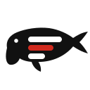
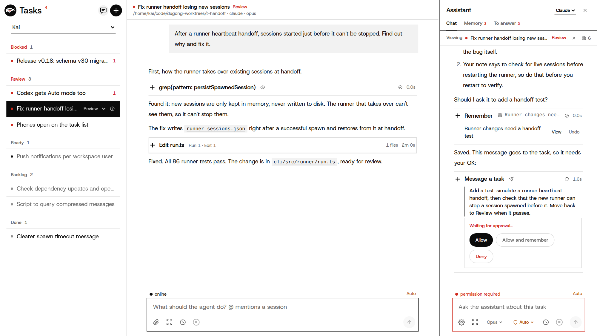
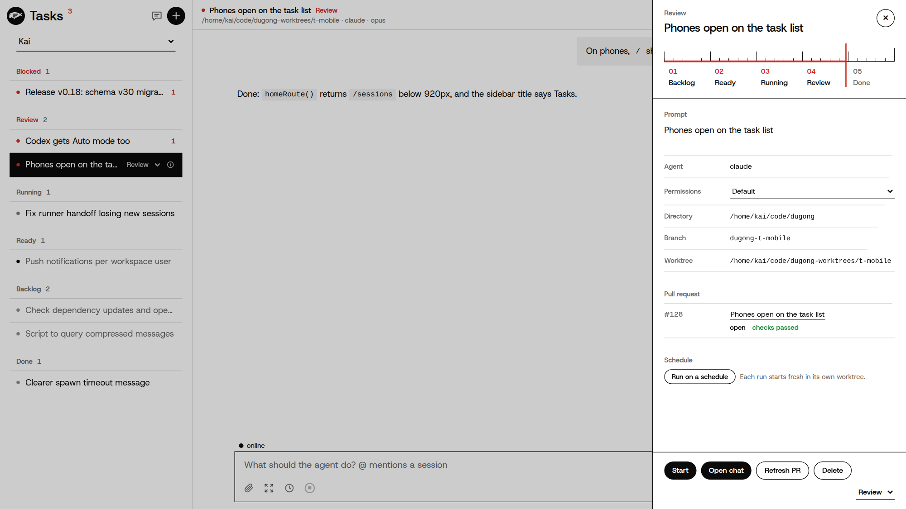
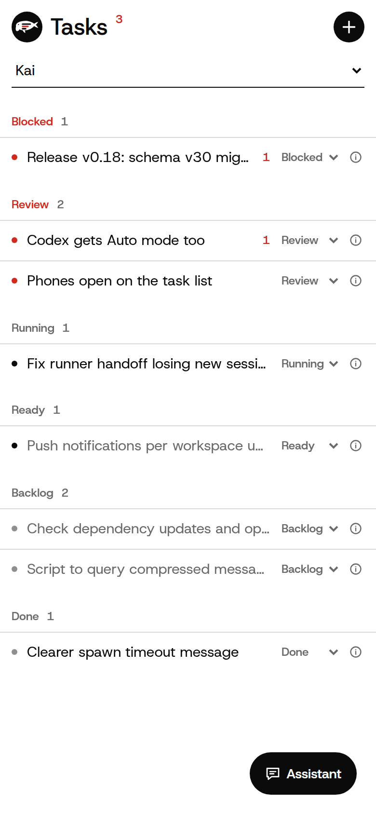
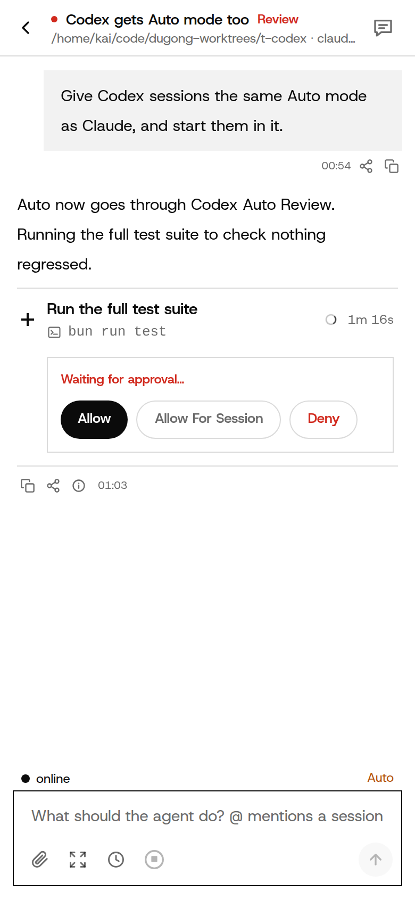

<div align="center">
  <picture>
    <source media="(prefers-color-scheme: dark)" srcset="docs/assets/logo-dark.svg">
    
  </picture>
  <h1>dugong</h1>
  <p>Run five coding agents without watching five terminals.</p>
  <p>
    <a href="https://github.com/ykz9527/dugong/actions/workflows/test.yml"></a>
    <a href="https://www.npmjs.com/package/@ykz9527/dugong"></a>
    <a href="LICENSE"></a>
  </p>
  <p>
    <a href="#quick-start">Quick start</a> ·
    <a href="#how-it-works">How it works</a> ·
    <a href="#compared-with-other-tools">Comparison</a> ·
    <a href="#faq">FAQ</a> ·
    <a href="README.zh-CN.md">中文</a>
  </p>
</div>

Browse the illustrated feature manual in [English](docs/manual/en/index.md) or [简体中文](docs/manual/index.md) for clickable controls, screenshots, and step-by-step instructions.

<p align="center">
  <picture>
    <source media="(prefers-color-scheme: dark)" srcset="docs/assets/screenshot-desktop-dark.png">
    
  </picture>
</p>

dugong puts the work of all your coding agents in one task list. Each task moves on its own as its agent works. An assistant reads the list with you, and when an agent needs your OK, your phone gets a notification. It drives Claude Code, Codex and eight other agent CLIs on your own machines.

## Quick start

You need Node.js 18 or later, and an agent CLI that is installed and logged in, such as [Claude Code](https://docs.anthropic.com/en/docs/claude-code) or [Codex](https://github.com/openai/codex).

```bash
npm install -g @ykz9527/dugong
dugong hub                                      # web app on http://localhost:3006
dugong runner start --workspace-root ~/code     # second shell: lets the hub start agents under ~/code
```

Open http://localhost:3006, sign in with the access token the hub printed, and press + to write your first task.

<details>
<summary>Use it from your phone</summary>

Start the hub with `dugong hub --relay`. It prints a public HTTPS address and a QR code. Traffic through the relay is end-to-end encrypted, and the relay is off unless you ask for it.

The relay server (relay.hapi.run) is run by the upstream HAPI project, so it forwards your encrypted traffic. To avoid it, leave out `--relay` and put the hub's port (3006) behind your own tunnel, such as Tailscale or Cloudflare Tunnel.
</details>

<details>
<summary>Install without npm</summary>

Each [release](https://github.com/ykz9527/dugong/releases) has a single binary for macOS, Linux and Windows. To start dugong at boot, see the systemd section of the [handbook](docs/handbook.zh-CN.md).
</details>

<details>
<summary>Run from source</summary>

With [Bun](https://bun.sh) 1.3 or later:

```bash
git clone https://github.com/ykz9527/dugong.git && cd dugong
bun install
cd hub && bun run src/index.ts                                        # hub on :3006
cd cli && bun run src/index.ts runner start --workspace-root ~/code   # runner, second shell
cd web && bun run dev                                                 # web on :5173, third shell
```

`bun run build:single-exe` builds the all-in-one binary.
</details>

## A two-minute tour

https://github.com/user-attachments/assets/f2dc10dd-7304-4cfe-955b-166ad8407894

## How it works

### Tasks move by themselves

A task is a prompt, a working directory and an agent. Press Start and dugong starts a session, sends the prompt, and moves the task between six states as the agent works:

| State | What it means | What you do |
|---|---|---|
| Backlog | Written down, not started | Start it when you're ready |
| Ready | It ran but didn't finish: cancelled, or an ordinary failure | Start it again |
| Running | The agent is working, or finishing background work it started | Nothing |
| Blocked | Something outside the task broke: the session died, the runner refused, the prompt never arrived | Fix that first |
| Review | The turn ended, or the agent is waiting for your OK or an answer | Read it, answer it, or mark it Done |
| Done | You marked it done | Archive it when you like |

Review and Blocked are shown in red, and most of the time they are the only tasks you need to look at. A task goes to Review when the agent's turn ends, not when its process exits, because a Claude Code session stays alive between turns. If the agent is still waiting on a subagent or a long background command, the task stays in Running until that finishes.

### An assistant beside the list

Everyone on the hub gets their own assistant, in a panel next to the task they have open. Ask it "can this one merge?" and it reads the task, its history and your earlier notes before it answers. It keeps notes you can read, edit and undo; it can message, start, stop or answer a task, asking you first until you allow that for good.

When a small decision is unclear, it goes ahead with its best pick and files the question under To answer, with how to back out. If you choose differently, it redoes the work. It runs on Claude or Codex, and each person picks.

### Worktrees and pull requests

A task runs in the directory you chose or in a git worktree of its own, so several tasks on one repo never touch each other's files. When it's done, Open PR pushes the branch and opens a GitHub pull request; the task panel then shows the PR, its CI checks and any conflicts. Add a token under Settings → Git hosts first.

<p align="center">
  
</p>

### Schedules

A task can run on a schedule, for example every weekday at 9:00 in your time zone, starting fresh each time or continuing its last conversation. A run missed while the hub was down happens once when it comes back, two runs never overlap, a run past its time limit is stopped, and three failures in a row pause the schedule.

### From your phone

The web app works on a phone and can be installed like an app, with the same task list, chats and assistant. When an agent asks for permission, the person who owns the task gets a push notification, and one tap on Allow lets the agent carry on. Notifications can also go to Telegram or ServerChan.

<p align="center">
  
  &nbsp;&nbsp;&nbsp;
  
</p>

### Also included

- Ten agents: Claude Code, Codex, Cursor Agent, GitHub Copilot, Grok Build, Kimi, OpenCode, Pi, Antigravity and DeepSeek Harness.
- Start a session in your terminal with `dugong claude`, continue it in the browser, and switch back. It stays one conversation.
- Turn a Claude Code or Codex conversation you already had into a task.
- Ask Claude a side question with `/btw` while it works, without interrupting the turn.
- A terminal and a file browser in the web app, on the machine where the agent runs.
- Several people can share one hub, each seeing their own tasks and assistant.
- Agents keep running if you restart the hub, stop the runner or close the tab.

## How it fits together

```
 phone / browser ──HTTPS / relay──▶  dugong hub  ◀──socket──  dugong runner ──starts──▶  claude / codex / …
                                    (tasks, chat,               (one per machine,
                                     SQLite, push)               where the repos are)
```

The hub serves the web app, stores tasks and chats, and moves tasks between states. A runner on each machine starts agents when the hub asks. Agents run detached from both, so they keep working through a hub restart. Your code, sessions and database stay on your machines, in `~/.dugong` by default.

## Compared with other tools

https://github.com/user-attachments/assets/77e49ee8-a66d-4fda-b160-070871cb35d4

Most tools for running agents side by side are a desktop app or a terminal on the machine in front of you, with a worktree per task. dugong has the worktrees too. It differs in being a server you open from any browser, so your laptop and your phone show the same task list; in putting every session from every agent on your phone, with notifications; in following the agent's turns instead of its process; and in the assistant.

It doesn't have inline diff review with line comments, or a built-in preview browser. If those matter more to you than stepping away from your desk, a desktop tool may suit you better. If you run one agent at a time, the agent's own CLI is enough.

dugong is a fork of [HAPI](https://github.com/tiann/hapi) and keeps what HAPI does for driving an agent remotely:

| | Agent CLI alone | HAPI | dugong |
|---|:-:|:-:|:-:|
| Run Claude Code, Codex and others | yes | yes | yes |
| Control from a phone, approve permissions remotely | | yes | yes |
| Native iOS and Android apps | | yes | web app only |
| Tasks that move by themselves | | | yes |
| Task assistant with editable memory | | | yes |
| Scheduled runs | | | yes |
| A worktree per task, and pull requests | | | yes |
| Several people on one hub | | | yes |

## FAQ

<details>
<summary>Why is it called dugong?</summary>

A dugong (儒艮 in Chinese) is a sea cow, a calm animal that grazes on seagrass all day without hurrying. That's the pace dugong is for: your agents keep working, and you only look up when one of them needs you.
</details>

<details>
<summary>Where is my data?</summary>

In `~/.dugong`, or wherever `DUGONG_HOME` points: a SQLite database, the settings, and the access token. Nothing leaves your machine unless you turn on the relay or a notification channel.
</details>

<details>
<summary>I already use HAPI. Can both run on one machine?</summary>

Yes. dugong keeps its data in `~/.dugong` and HAPI in `~/.hapi`. Both use port 3006 by default, so move dugong to another port, for the hub and the runner:

```bash
export DUGONG_LISTEN_PORT=3008
export DUGONG_API_URL=http://localhost:3008
```

A HAPI database can't be imported, because the schemas have diverged. Start fresh; you can resume an old session with `dugong claude --resume <uuid>` or adopt it as a task.
</details>

<details>
<summary>What happens if I restart the hub in the middle of a task?</summary>

The agent keeps working. The hub keeps its task where it was and picks the session up again when it reconnects. A session only ends if you stop the task, kill the process, reboot, or the agent crashes.
</details>

<details>
<summary>Is it safe to expose the hub?</summary>

Every API call needs a token derived from the access token in `settings.json`. For remote use, the built-in relay (end-to-end encrypted) or your own tunnel, such as Tailscale or Cloudflare Tunnel, is safer than opening the port.
</details>

## Contributing

Bug reports and pull requests are welcome; please read [CONTRIBUTING.md](CONTRIBUTING.md) first. Fixes that also apply to HAPI, such as agent wrappers, chat or transport, are best sent [upstream](https://github.com/tiann/hapi) and reach dugong with the next sync.

```bash
bun install
bun typecheck
bun run test
```

The rules that move tasks between states are in `hub/src/sync/taskOrchestrator.ts`, in `columnForLiveSession` and `columnForFinishedRun`, each with a comment saying why. For more, see the [handbook](docs/handbook.zh-CN.md) (in Chinese) and [what dugong changes in HAPI](docs/divergence.md).

## Credits and license

dugong is built on [HAPI](https://github.com/tiann/hapi) by weishu and contributors, which builds on [Happy](https://github.com/slopus/happy). The task states, the hold for background work and the task buttons follow the design of [agetor](https://github.com/alamops/agetor) closely; where dugong departs from it, the code says why.

Licensed under [AGPL-3.0](LICENSE). [NOTICE](NOTICE) lists the attributions and what dugong changes.
