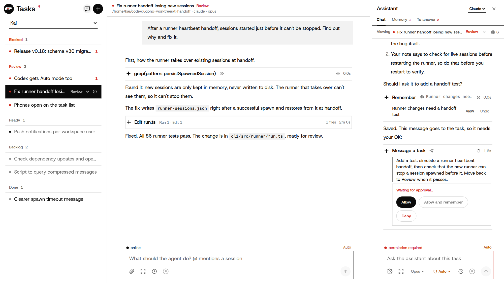
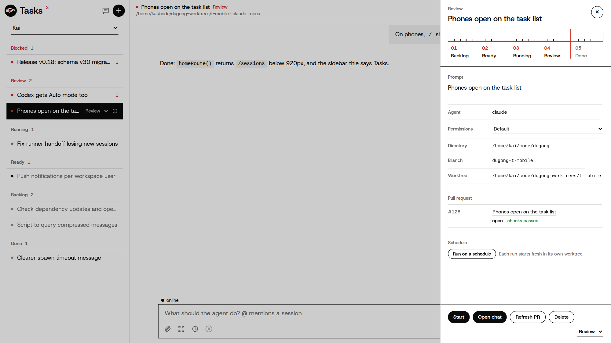
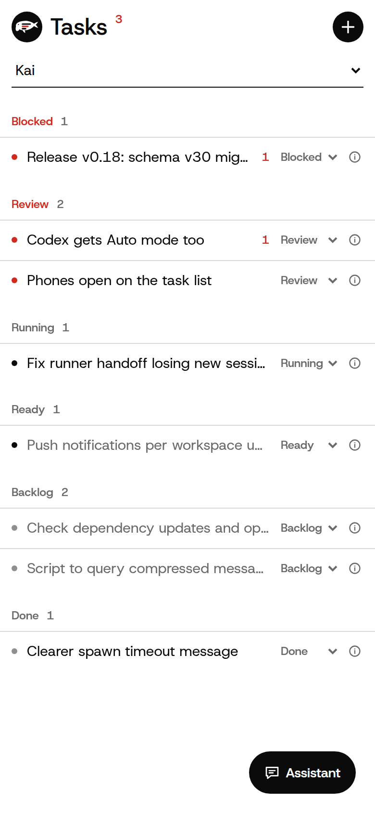
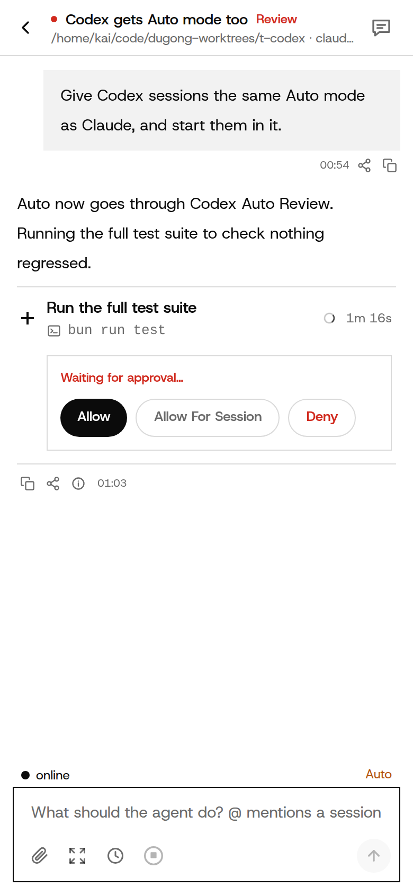

<div align="center">
  <picture>
    <source media="(prefers-color-scheme: dark)" srcset="docs/assets/logo-dark.svg">
    
  </picture>
  <h1>dugong · 儒艮</h1>
  <p>同时跑五个编码 agent，不用开五个终端盯着。</p>
  <p>
    <a href="https://github.com/ykz9527/dugong/actions/workflows/test.yml"></a>
    <a href="https://www.npmjs.com/package/@ykz9527/dugong"></a>
    <a href="LICENSE"></a>
  </p>
  <p>
    <a href="#快速开始">快速开始</a> ·
    <a href="#怎么用">怎么用</a> ·
    <a href="#和其他工具比">对比</a> ·
    <a href="#常见问题">常见问题</a> ·
    <a href="README.md">English</a>
  </p>
</div>

按界面入口查操作方法：[中文功能图文手册](docs/manual/index.md) · [English manual](docs/manual/en/index.md)，包含功能目录、截图和逐步说明。

<p align="center">
  <picture>
    <source media="(prefers-color-scheme: dark)" srcset="docs/assets/screenshot-desktop-dark.png">
    
  </picture>
</p>

dugong 把你所有编码 agent 的活放进一张任务清单。agent 干到哪一步，任务就自己挪到哪一步。旁边有个助手和你一起看这张清单；哪个 agent 需要你点头，手机上就会收到通知。它驱动的是你自己机器上的 Claude Code、Codex，以及另外八种 agent CLI。

## 快速开始

需要 Node.js 18 以上，以及一个装好并登录了的 agent CLI，比如 [Claude Code](https://docs.anthropic.com/en/docs/claude-code) 或 [Codex](https://github.com/openai/codex)。

```bash
npm install -g @ykz9527/dugong
dugong hub                                      # 网页在 http://localhost:3006
dugong runner start --workspace-root ~/code     # 另开一个终端：允许 hub 在 ~/code 下启动 agent
```

打开 http://localhost:3006，用 hub 打印出来的 access token 登录，点 + 写第一个任务。

<details>
<summary>在手机上用</summary>

用 `dugong hub --relay` 启动。它会打印一个公网 HTTPS 地址和一个二维码。经过中转的流量是端到端加密的，不加 `--relay` 就不会打开中转。

中转服务器（relay.hapi.run）由上游 HAPI 项目运行，你的加密流量会经过它转发。不想用它的话，就不加 `--relay`，用自己的隧道（比如 Tailscale 或 Cloudflare Tunnel）把 hub 的端口（3006）暴露出去。
</details>

<details>
<summary>不用 npm 安装</summary>

每个 [release](https://github.com/ykz9527/dugong/releases) 都有 macOS、Linux、Windows 的单文件版本。开机自启见[使用手册](docs/handbook.zh-CN.md)里 systemd 那一节。
</details>

<details>
<summary>从源码运行</summary>

需要 [Bun](https://bun.sh) 1.3 以上：

```bash
git clone https://github.com/ykz9527/dugong.git && cd dugong
bun install
cd hub && bun run src/index.ts                                        # hub，在 :3006
cd cli && bun run src/index.ts runner start --workspace-root ~/code   # runner，另开一个终端
cd web && bun run dev                                                 # 网页，在 :5173，再开一个终端
```

`bun run build:single-exe` 可以打成单文件。
</details>

## 两分钟看完

https://github.com/user-attachments/assets/de2d44ee-fe37-4f9d-bcdc-25b4480315af

## 怎么用

### 任务自己流转

一个任务就是一段 prompt、一个工作目录和一个 agent。点开始，dugong 起会话、发 prompt，之后随着 agent 的进展，任务在六种状态之间自己挪：

| 状态 | 意思 | 你要做的 |
|---|---|---|
| 待办 Backlog | 写下了，还没开始 | 想开始的时候点开始 |
| 就绪 Ready | 跑过，但没跑完：被取消，或者普通的失败 | 再开始一次 |
| 运行中 Running | agent 在干活，或者在等它自己开的后台任务跑完 | 不用管 |
| 受阻 Blocked | 任务之外的东西坏了：会话断了、runner 拒绝了、prompt 没送到 | 先把那个问题解决 |
| 待审阅 Review | 这一轮结束了，或者 agent 在等你批准、等你回答 | 看结果、回答它，或者标成完成 |
| 完成 Done | 你标的 | 想归档就归档 |

待审阅和受阻是红色的，大多数时候你只需要看这两组。任务进待审阅，看的是 agent 这一轮有没有结束，不是进程有没有退出，因为 Claude Code 的会话在两轮之间一直活着。如果 agent 还在等 subagent 或者一条很长的后台命令，任务会留在运行中，等它跑完。

### 旁边有个助手

用这个 hub 的每个人都有自己的助手，就在打开的任务旁边。问它"这个能合了吗"，它会先看任务、历史和你以前交代过的话，再回答。它记的笔记你都能看、能改、能撤销；它能给任务发消息、开始或停止任务、替任务回答问题，每次都先问你，直到你允许它以后不用问。

拿不准的小决定，它先按自己的判断做下去，把问题记进"待答"，写上选错了怎么退回去。你选了别的，它会回去重做。助手背后可以是 Claude，也可以是 Codex，每个人自己选。

### worktree 和 PR

任务可以直接在你选的目录里跑，也可以在自己的 git worktree 里跑，这样同一个仓库里的几个任务不会互相改到对方的文件。做完后点 Open PR，会推送分支并在 GitHub 上开 PR，任务面板里能看到 PR、CI 状态和有没有冲突。用之前先在 Settings → Git hosts 里加 token。

<p align="center">
  
</p>

### 定时运行

任务可以定时跑，比如按你的时区每个工作日早上 9 点，每次从头开始，或者接着上一次的对话。hub 停机期间错过的那次，恢复后补跑一次；两次运行不会叠在一起；超过时间上限的会被停掉；连续失败三次，定时会自动暂停。

### 在手机上

网页在手机上也能用，还可以像 app 一样装到桌面上，任务清单、对话和助手都和电脑上一样。agent 要权限时，任务主人的手机会收到推送，点一下 Allow 它就接着跑。通知也可以发到 Telegram 或 Server 酱。

<p align="center">
  
  &nbsp;&nbsp;&nbsp;
  
</p>

### 其他还有

- 十种 agent：Claude Code、Codex、Cursor Agent、GitHub Copilot、Grok Build、Kimi、OpenCode、Pi、Antigravity、DeepSeek Harness。
- 在终端里用 `dugong claude` 开一个会话，到浏览器里接着聊，再切回终端，始终是同一段对话。
- 以前在 Claude Code 或 Codex 里聊过的对话，可以接管成一个任务。
- Claude 干活时，可以用 `/btw` 插一句问它，不会打断这一轮。
- 网页里有终端和文件浏览，对应 agent 所在的那台机器。
- 几个人可以共用一个 hub，每个人只看到自己的任务和助手。
- 重启 hub、停掉 runner、关掉网页，agent 都会接着跑。

## 整体结构

```
 手机 / 浏览器 ──HTTPS / 中转──▶  dugong hub  ◀──socket──  dugong runner ──启动──▶  claude / codex / …
                                (任务、对话、               （每台机器一个，
                                 SQLite、推送）               仓库在哪台机器上就装在哪）
```

hub 提供网页，存任务和对话，负责把任务在状态之间挪。每台机器上的 runner 按 hub 的要求启动 agent。agent 和这两者是分开跑的，hub 重启时它照样干活。代码、会话和数据库都留在你自己的机器上，默认在 `~/.dugong`。

## 和其他工具比

https://github.com/user-attachments/assets/79458a0d-4736-47c5-9ff2-51736beefd2a

大多数并行跑 agent 的工具，是装在你面前这台机器上的桌面应用或终端，每个任务给一个 worktree。worktree 这点 dugong 也有。不同的地方在于：它是一个服务，任何浏览器都能打开，笔记本上和手机上是同一张任务清单；手机上能看到所有 agent 的所有会话，有通知；任务状态跟着 agent 的每一轮走，不看进程；另外还有助手。

它没有带行内评论的 diff 评审，也没有内置的预览浏览器。如果这两样对你来说比"能离开电脑"更重要，桌面工具可能更合适。如果你一次只跑一个 agent，用 agent 自己的 CLI 就够了。

dugong 是 [HAPI](https://github.com/tiann/hapi) 的 fork，HAPI 远程驱动 agent 的能力它都保留了：

| | 只用 agent CLI | HAPI | dugong |
|---|:-:|:-:|:-:|
| 跑 Claude Code、Codex 等 | 有 | 有 | 有 |
| 在手机上控制、远程批准权限 | | 有 | 有 |
| 原生 iOS / Android app | | 有 | 只有网页版 |
| 任务自己流转 | | | 有 |
| 记忆可编辑的任务助手 | | | 有 |
| 定时运行 | | | 有 |
| 每个任务一个 worktree，以及 PR | | | 有 |
| 几个人共用一个 hub | | | 有 |

## 常见问题

<details>
<summary>为什么叫 dugong？</summary>

dugong 就是儒艮，一种性情温和的海洋动物，整天不慌不忙地吃海草。dugong 想给你的就是这种节奏：agent 们一直在干活，只有哪个需要你，你才抬头看一眼。
</details>

<details>
<summary>我的数据存在哪？</summary>

在 `~/.dugong`，可以用 `DUGONG_HOME` 改位置。里面是一个 SQLite 数据库、设置和 access token。不开中转、不配通知渠道的话，什么都不会离开你的机器。
</details>

<details>
<summary>我已经在用 HAPI 了，两个能装在一台机器上吗？</summary>

能。dugong 的数据在 `~/.dugong`，HAPI 的在 `~/.hapi`。两者默认都用 3006 端口，所以给 dugong 换一个端口，hub 和 runner 都要设：

```bash
export DUGONG_LISTEN_PORT=3008
export DUGONG_API_URL=http://localhost:3008
```

HAPI 的数据库导不进来，两边的表结构已经分开了。从空库开始就行；想留的会话，可以用 `dugong claude --resume <uuid>` 接回来，或者接管成一个任务。
</details>

<details>
<summary>任务跑到一半重启 hub 会怎样？</summary>

agent 会接着干。hub 把它的任务原样留着，等会话重新连上再接着跟。只有你停掉任务、杀掉进程、重启机器，或者 agent 自己崩了，会话才会结束。
</details>

<details>
<summary>把 hub 暴露到公网安全吗？</summary>

每个 API 请求都要带一个由 `settings.json` 里的 access token 派生出来的 token。远程使用时，内置的中转（端到端加密）或者你自己的隧道（比如 Tailscale、Cloudflare Tunnel）都比直接开放端口安全。
</details>

## 参与贡献

欢迎提 bug 和 PR，提之前请先看 [CONTRIBUTING.md](CONTRIBUTING.md)。如果修的东西 HAPI 也用得上，比如 agent 的包装、聊天、传输层，最好直接提给[上游](https://github.com/tiann/hapi)，下次同步时就会进到 dugong。

```bash
bun install
bun typecheck
bun run test
```

任务在状态之间怎么挪，规则都在 `hub/src/sync/taskOrchestrator.ts` 的 `columnForLiveSession` 和 `columnForFinishedRun` 里，每条规则都写了为什么。更多内容见[使用手册](docs/handbook.zh-CN.md)和 [dugong 改了 HAPI 的哪些地方](docs/divergence.md)（英文）。

## 致谢和许可证

dugong 建立在 weishu 和贡献者们的 [HAPI](https://github.com/tiann/hapi) 之上，HAPI 又建立在 [Happy](https://github.com/slopus/happy) 之上。任务状态、后台任务的等待规则和任务按钮基本照着 [agetor](https://github.com/alamops/agetor) 的设计做；和它不一样的地方，代码里都写了原因。

许可证是 [AGPL-3.0](LICENSE)。[NOTICE](NOTICE) 里列了署名，以及 dugong 改了什么。
