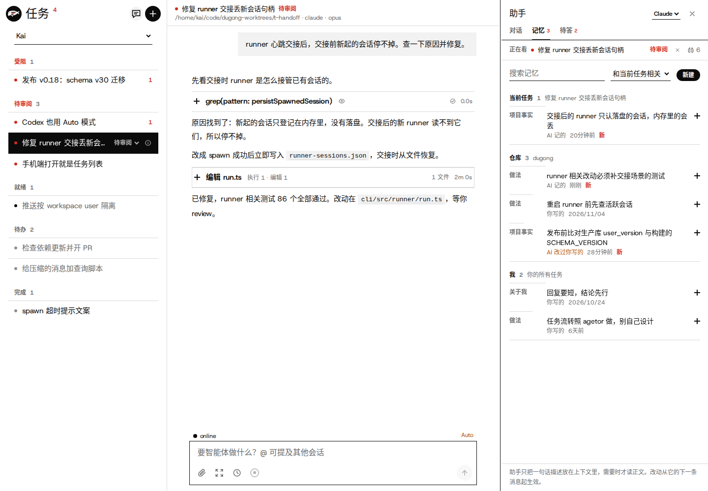
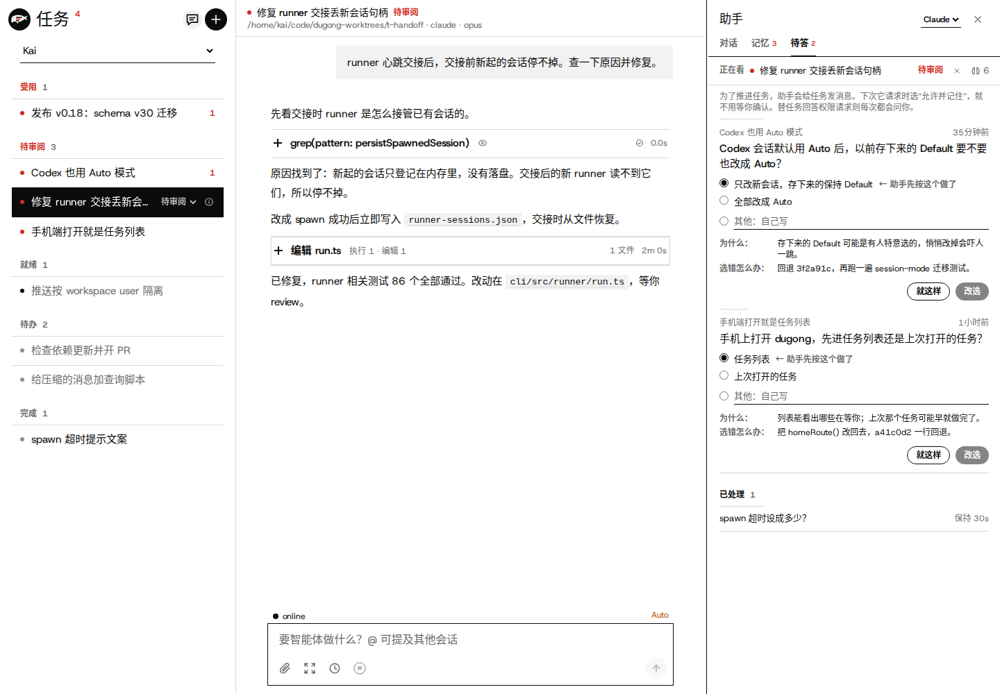

# 任务助手、记忆与待答

[返回功能目录](index.md)

助手帮助你查看任务并处理跨任务信息。选择的工作区用户决定使用哪位助手及其记忆范围。

## 打开助手并限定任务范围

1. 点“任务助手”按钮打开面板。
2. 选择 Claude 或 Codex 等当前界面提供的后端，并等待助手可用。
3. 选中任务后，查看面板中的“正在看”；提问时该任务会作为上下文。
4. 点取消当前任务范围的按钮，可以询问所有可见任务。
5. 输入“总结这个任务还缺什么验收”，检查助手的答复和引用。

助手可能提出给任务发消息、记忆更新等操作。是否已经执行，以操作卡片和目标会话实际变化为准。

## 查看、新建和编辑记忆

1. 切换到“记忆”，使用搜索或“相关/全部”筛选。
2. 查看当前任务、仓库和“我”的分组；不同范围影响哪些任务会使用记忆。
3. 点“新建”，填写一句话描述、类型、名称与正文，保存。
4. 点已有条目打开编辑，修改后保存；不再适用时使用条目的删除操作。
5. AI 修改过你写的内容时，可以查看原文并选择撤销 AI 修改。

一句话描述会供助手识别记忆，需要时再读取正文。修改从后续消息起生效，不会重写已经结束的对话。

## 处理待答问题

1. 切换“待答”，阅读问题、助手选项、理由和选错后的处理方式。
2. 同意当前决定时点“就这样”。
3. 不同意时点“改选”，选择其他选项或填写自己的答案。
4. 检查条目变成已处理，并查看相关任务的后续变化。

如果提示答案已记录但无法通知助手返工，请在助手对话中明确补发说明。

## 管理免确认操作

1. 在记忆页下方查看“免确认的操作”。
2. 需要收回某项授权时点“撤销”。
3. 下次助手发起该操作时，应重新出现确认请求。

“允许并记住”会改变后续授权体验。替任务回答权限请求仍可能要求逐次确认；不要把助手授权理解为给所有任务开放全部权限。

## 界面与行为依据

`web/src/components/Assistant/AssistantHost.tsx`、`web/src/lib/locales/zh-CN.ts`。截图使用真实组件和演示数据；不代表演示中操作已在真实机器执行。
