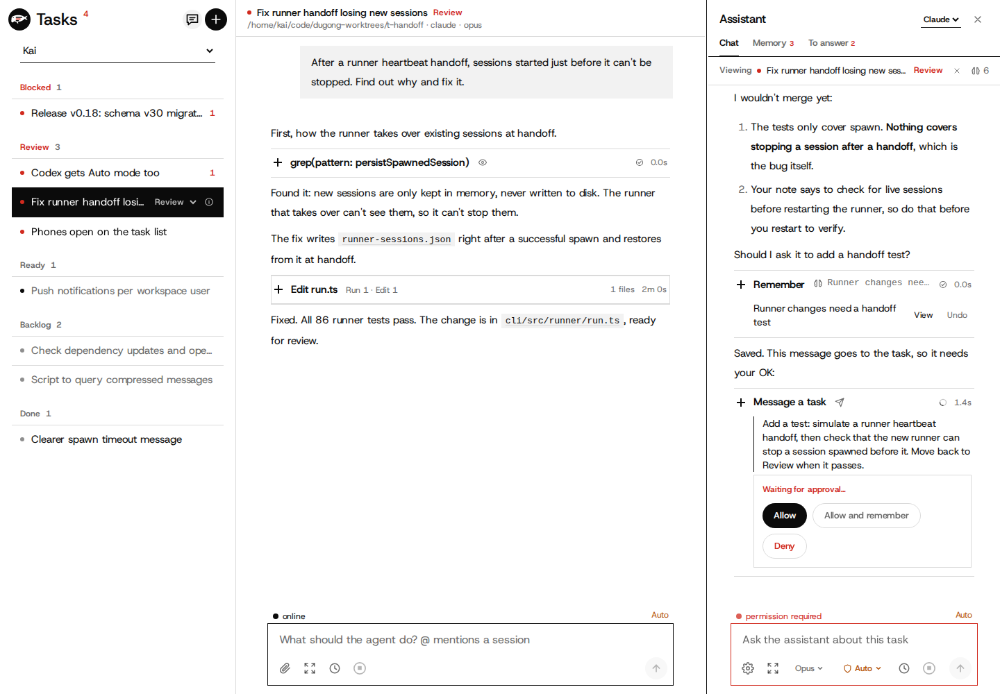
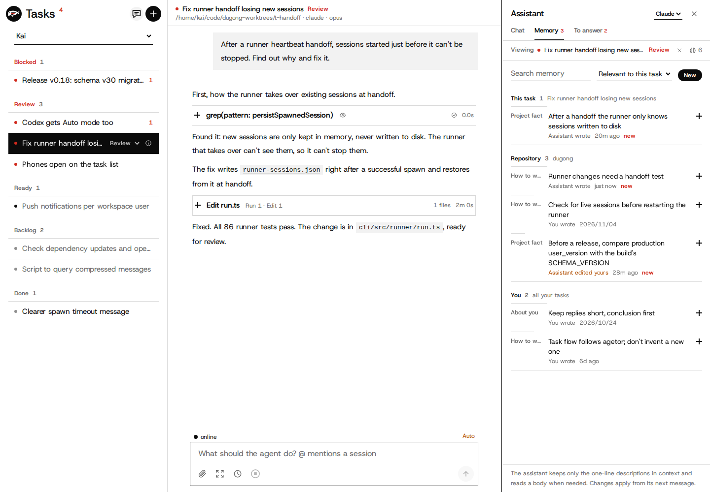
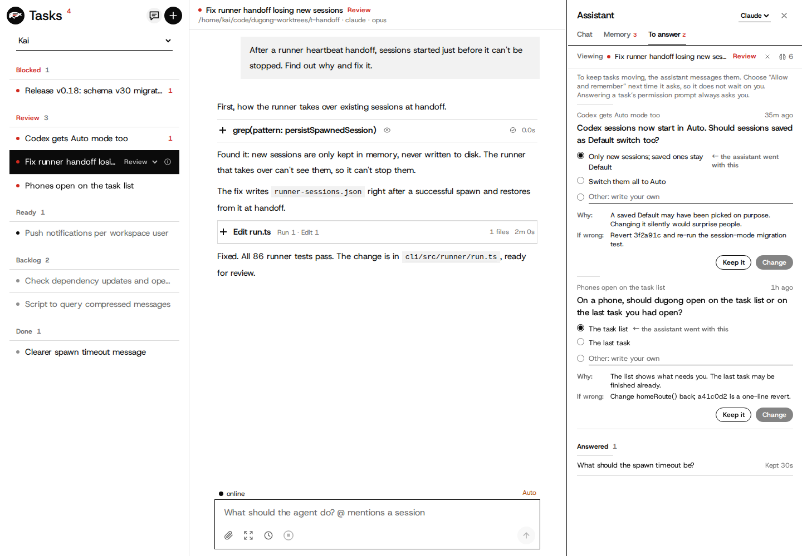

# Task assistant, memory and questions

[English](./assistant.md) · [简体中文](../assistant.md) · [Feature directory](index.md)

The assistant helps you inspect work and handle information across tasks. The selected workspace user determines the assistant and memory scope.

## Open the assistant and select a task scope

1. Click Task assistant to open the panel.
2. Select Claude, Codex or another backend currently offered, and wait for it to become available.
3. After selecting a task, check the task indicator in the panel. That task becomes context for your question.
4. Clear the selected-task scope to ask about all visible tasks.
5. Ask something concrete, such as “What acceptance checks are still missing for this task?”, then inspect the answer and references.

The assistant may propose messaging a task or updating memory. Check the action card and target conversation to determine what actually happened.

## Read, create and edit memory

1. Open Memory. Use search and the related/all filter to narrow the list.
2. Check the current-task, repository and user groups. The scope determines which tasks can use an entry.
3. Click New and enter a short description, type, name and body, then save.
4. Open an entry to edit it. Save changes or delete entries that no longer apply.
5. If AI changed something you wrote, inspect the previous text and choose whether to undo its change.

The short description helps the assistant find an entry; it reads the body when needed. Changes affect subsequent messages, not conversations already completed.

## Handle pending questions

1. Open To answer and read the question, provisional choice, rationale and recovery plan.
2. Keep the decision if you agree.
3. Otherwise choose a different option or enter your own answer.
4. Confirm that the item is marked as handled and inspect the related task's follow-up.

If the answer was saved but the assistant could not be notified to rework the task, send a clear follow-up in the assistant conversation.

## Manage operations that no longer ask

1. Open the remembered-permissions area below the memory list.
2. Revoke an operation when you want the assistant to ask again.
3. Check that a new confirmation appears the next time it requests that operation.

Allow and remember changes future approval behavior. Answering a task's permission requests may still require approval each time; an assistant grant does not give every task unrestricted access.

## Interface and behavior references

`web/src/components/Assistant/AssistantHost.tsx`, `web/src/lib/locales/zh-CN.ts`. Screenshots use production components with synthetic data. They do not show operations being executed on a real machine.
