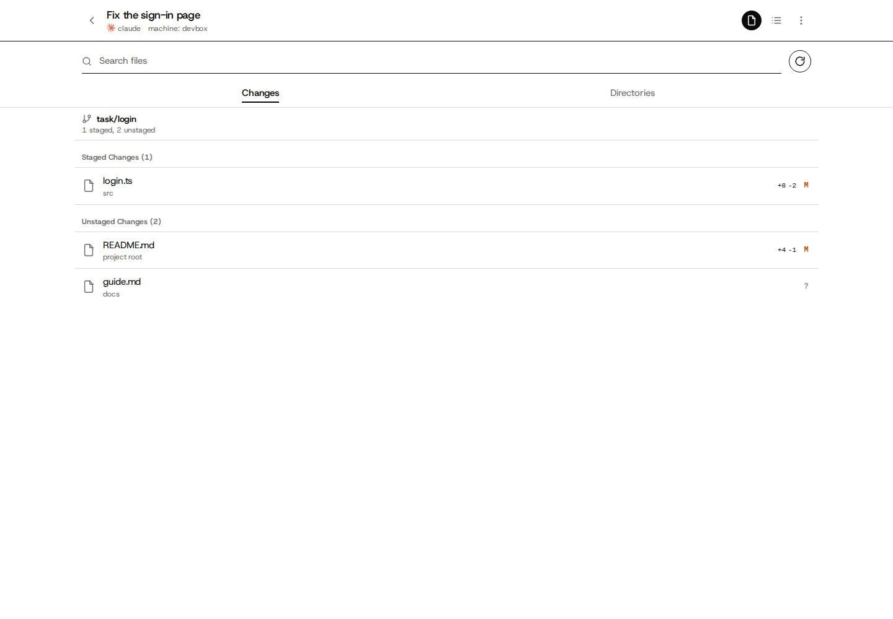
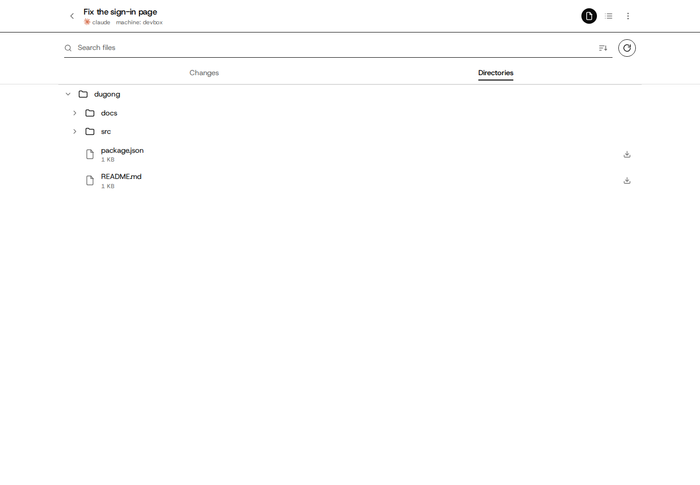
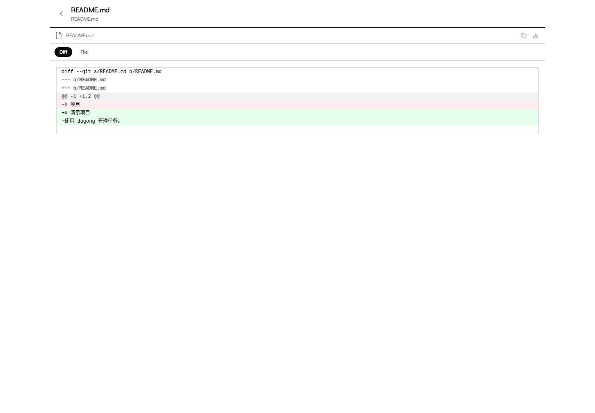

# Browse files, search and inspect diffs

[English](./files.md) · [简体中文](../files.md) · [Feature directory](index.md)

Open files from a session to inspect the execution machine's working directory.

## Inspect staged and unstaged changes

1. Open the session's file view and select Changes.
2. Distinguish staged, unstaged and untracked files.
3. Click a file to view its content or diff, checking the path and staged indicator.
4. Refresh when the agent has made further changes.

The list reflects the Git working directory, not only the last answer's output. In Simple mode it may include another task's changes or manual edits.

## Browse directories, search and sort

1. Switch to Directories. Open folders and use the path or back controls to move upward.
2. Enter a search query and open a matching file.
3. Use the available sort controls to change the order.
4. If a file is missing, check the session directory, machine connection and permissions.

Search results and readable paths depend on the current directory and server capabilities.

## Read source, Markdown and diffs

1. Check the file path after opening it; copy the path when needed.
2. For Markdown, switch between Source and Preview.
3. When arriving from Changes, check whether you are inspecting the staged or unstaged diff.
4. Use the available copy or download controls, then return to the file list.

This view primarily displays files. To edit, ask the agent or use your terminal or local editor. Viewing a preview does not save an edit.

## Interface and behavior references

`web/src/routes/sessions/files.tsx`, `web/src/routes/sessions/file.tsx`. Screenshots use production components with synthetic data. They do not show operations being executed on a real machine.
