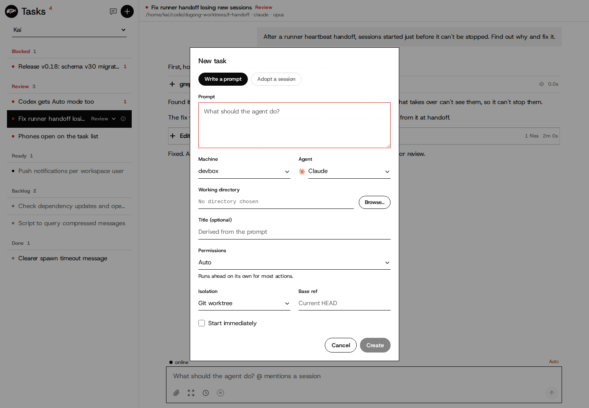
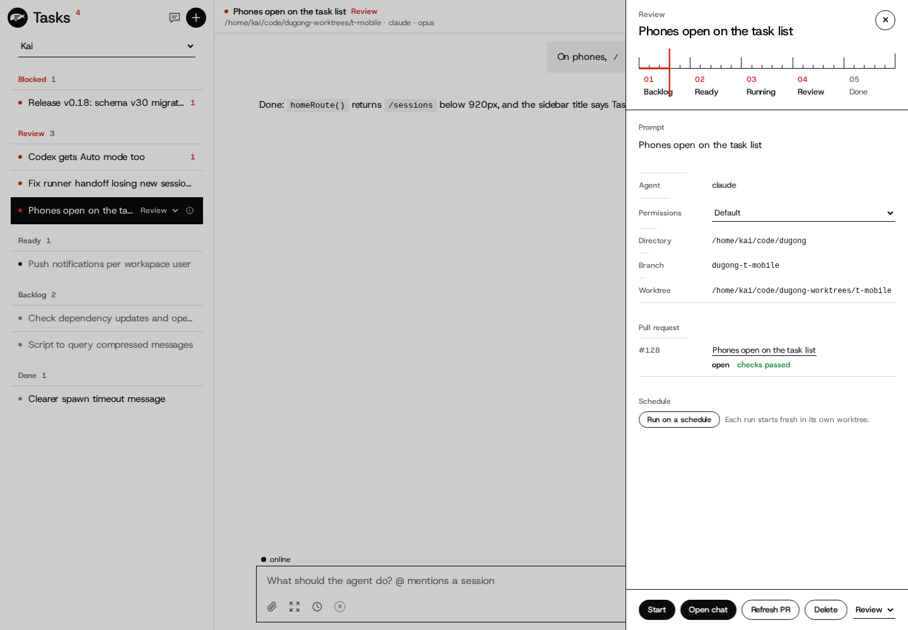

# Worktrees, branches and pull requests

[English](./git.md) · [简体中文](../git.md) · [Feature directory](index.md)

Use a worktree to isolate task changes. Task details show the branch and pull request.

## Choose task isolation

1. When creating a task, choose Worktree and confirm that the directory is a Git repository.
2. Supply the base ref you need. Check the repository's default branch if you are unsure.
3. After starting, open details and inspect the actual branch and worktree path.

Simple mode uses the original directory. Concurrent tasks and manual edits can affect the same Git state. Worktrees isolate working files, but do not automatically isolate ports, databases or external services.

## Open and refresh a PR

1. Finish the implementation, checks and necessary commits in the agent conversation.
2. In task details, verify the branch, base ref and changes.
3. When Open PR is available, click it and follow the returned link to your hosting service.
4. Click Refresh PR to update the status, checks, draft indicator and conflict information.

This needs an appropriate Git remote, a pushable branch and hosting credentials. See [Git hosting](settings-git.md). The task view does not replace the hosting service's final merge checks, and does not promise automatic merging.

## Read run history

1. Open task details and scroll to Run history.
2. Distinguish successful, failed, canceled, interrupted and timed-out runs.
3. Open the associated session to inspect its output. Do not mistake an older run for the latest result.

The task's current status and a historical run's outcome are separate facts. For scheduled tasks, also check the trigger time and schedule records.

## Interface and behavior references

`web/src/components/Tasks/TaskDetail.tsx`, `web/src/components/Tasks/useTaskLifecycle.ts`. Screenshots use production components with synthetic data. They do not show operations being executed on a real machine.
