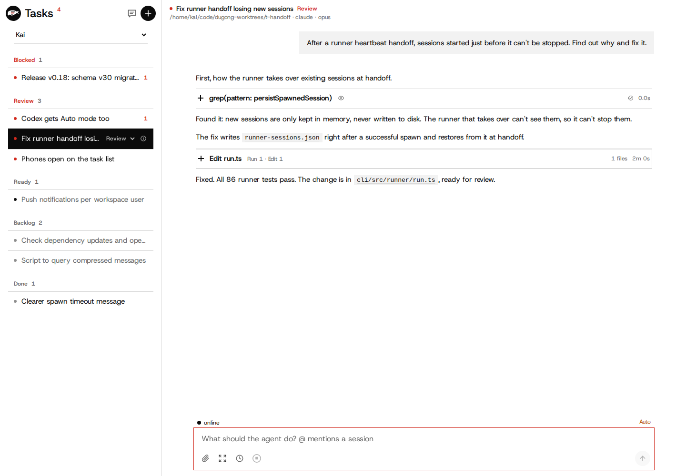

# Write messages and read results

[English](./messages.md) · [简体中文](../messages.md) · [Feature directory](index.md)

The composer controls the current session. You can customize its toolbar in Settings; check hidden tools if a button is missing.

## Write, send and abort

1. Write your request and click Send. Whether Enter sends depends on your chat settings.
2. Use Expand editor for a long prompt, then return to the regular composer.
3. While the agent is busy, use the immediate, queued or other delivery options the interface offers. Agent support varies.
4. To stop the current work, click Abort and wait for the status to update.

Aborting does not undo files the agent has already changed. Check message delivery status before retrying on an unstable connection.

## Attach files and reference sessions

1. Click Add file and select the images or files you need. Supported inputs also accept paste or drag-and-drop.
2. Check each attachment's name and upload state before sending.
3. Use the composer's `@` suggestions to insert a session reference, then verify the target.
4. Type `/` to see commands provided by the current agent. Use the commands actually offered in that list.

Attachment support depends on the agent. Inspect sensitive files before attaching them. A filename appearing in the composer does not by itself prove the upload has completed.

## Choose models, effort and permissions

1. Click the model control and select a model supported by the current agent.
2. If reasoning effort or fast-mode controls are available, choose the settings your task needs.
3. Read the permission-mode descriptions before changing the mode.

| Control | Determines |
| --- | --- |
| Model | Which model handles the request |
| Reasoning effort | The effort level for agents that support it |
| Permissions | Which tool operations require confirmation |
| Local or remote control | Whether interaction is controlled from the terminal or web interface |

Permission modes govern execution authority. Avoid granting more access merely to reduce the number of prompts.

## Read tool output, code and history

1. Expand a tool card to inspect a command, edit or execution result. Click again to collapse it.
2. Use Copy beside a message to copy text. Code blocks may have their own copy control.
3. Open images, diagrams and Markdown links through the preview controls offered by the interface.
4. Use the outline or history scrolling to navigate long conversations. History that has not loaded is not necessarily deleted.

The current release candidate still has failing history-scrolling browser checks. This guide does not claim those scenarios have passed acceptance testing.

## Interface and behavior references

`web/src/components/AssistantChat/ComposerButtons.tsx`, `web/src/components/AssistantChat/HappyComposer.tsx`, `web/src/components/SessionHeader.tsx`. Screenshots use production components with synthetic data. They do not show operations being executed on a real machine.
