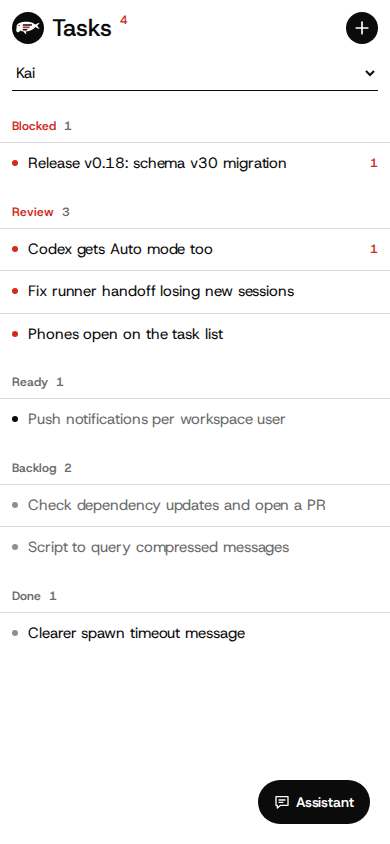

# Notifications and offline use

[English](./notifications.md) · [简体中文](../notifications.md) · [Feature directory](index.md)

Notifications tell you when an agent needs attention. Execution still happens through the hub and runner machine.

## Enable browser notifications

1. Open your HTTPS hub and use the browser's install option to add it to your home screen.
2. Allow notifications when the application or browser offers the permission prompt.
3. Check that system settings do not block notifications for the browser or PWA.
4. Use a controlled approval request to verify that a notification arrives.

The screenshot shows the mobile task list. System notification dialogs vary by device and are not a fixed dugong button. Open the session to verify its current state after receiving a notification.

## Recover a connection and use multiple devices

1. When disconnected, check the offline indicator instead of repeatedly pressing Send.
2. After reconnecting, wait for the list and conversation to refresh.
3. Check delivery status before deciding whether to resend a message.
4. On another device, use the same hub with the intended credentials and workspace user.

Installing the PWA does not run the agent on your phone. For server-side notification channels, see [Notifications](../../guide/notifications.md).

## Interface and behavior references

`docs/guide/pwa.md`, `docs/guide/notifications.md`. Screenshots use production components with synthetic data. They do not show operations being executed on a real machine.
