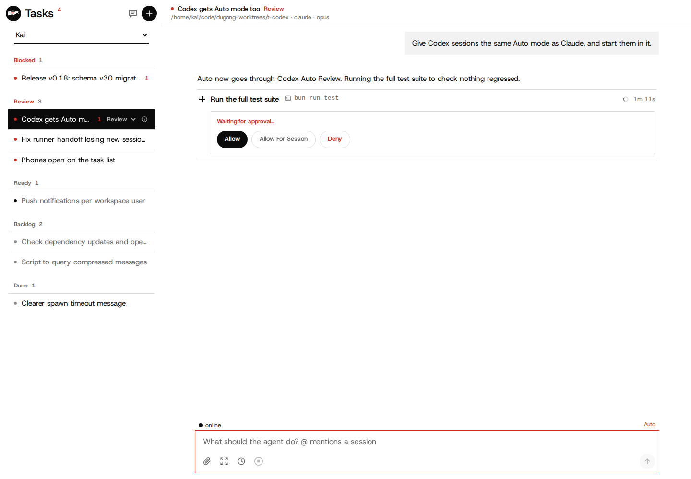
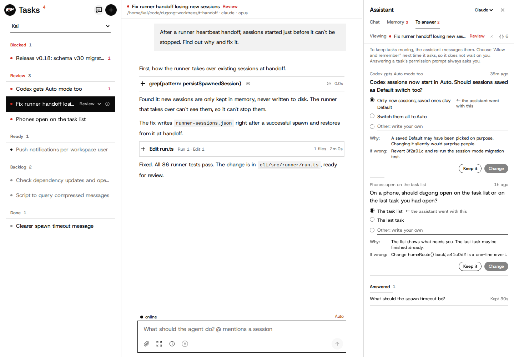

# Approve operations and answer questions

[English](./permissions.md) · [简体中文](../permissions.md) · [Feature directory](index.md)

Requests for tool execution or a decision appear as interactive cards. Read the request before choosing an action.

## Allow or deny a tool operation

1. Open the task or session showing a pending approval.
2. Expand the request and inspect its command, arguments, working directory and file paths.
3. Click Allow to permit the operation, or Deny to refuse it.
4. Use a persistent approval option only when you want the stated future operations to proceed without asking again.
5. Wait for the card to update, then read the agent's next output.

A shortcut in task details may say that the tool will no longer ask during this session. Follow the scope shown beside the actual button.

## Answer an agent question

A question inside a conversation and the assistant's To answer tab are separate entry points. A conversation card asks you to choose an option or submit text. To answer lets you confirm or change a decision the assistant provisionally made.

1. Read the question and option descriptions.
2. Choose an option and add free text if necessary.
3. Submit and confirm that the item is marked as handled.

This screenshot shows the assistant's To answer tab. See [Handling pending questions](assistant.md#questions) for keeping or changing its decision. Closing a panel does not submit an answer.

## Interface and behavior references

`web/src/components/ToolCard/PermissionFooter.tsx`, `web/src/components/ToolCard/AskUserQuestionFooter.tsx`, `web/src/components/Tasks/TaskDetail.tsx`. Screenshots use production components with synthetic data. They do not show operations being executed on a real machine.
