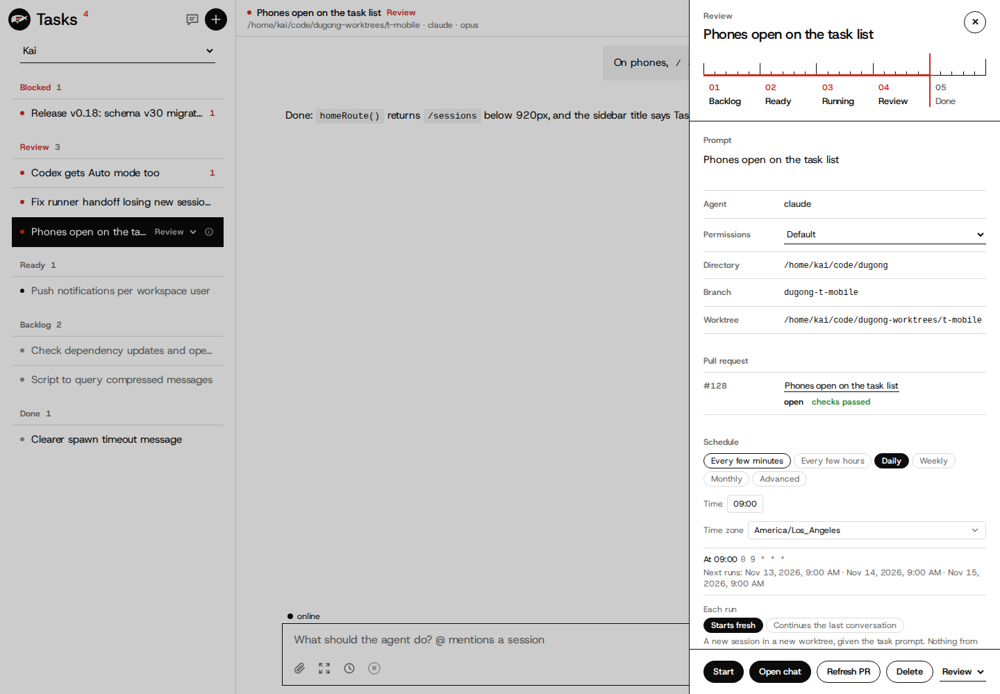
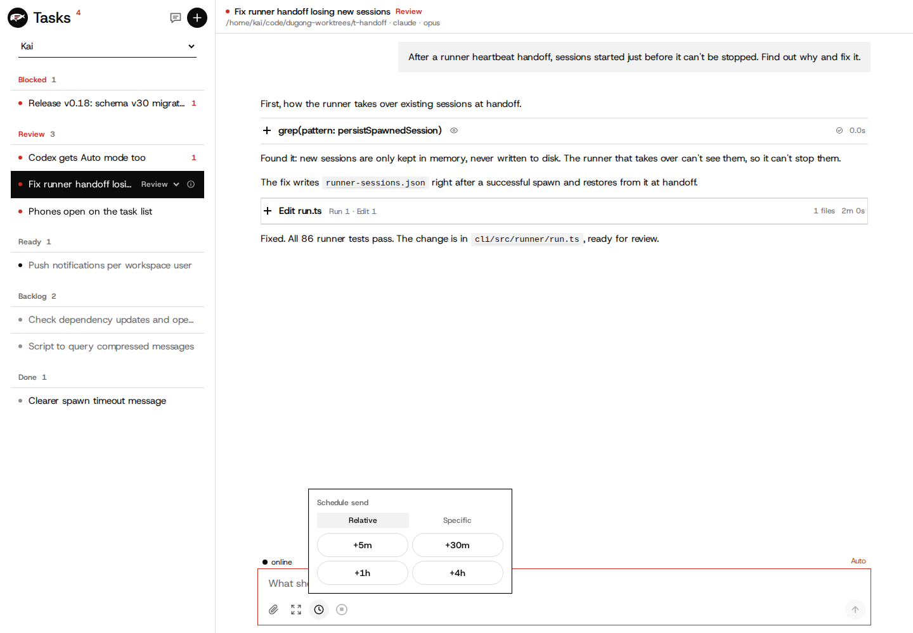

# Recurring tasks and scheduled messages

[English](./schedules.md) · [简体中文](../schedules.md) · [Feature directory](index.md)

Task details schedule an entire task. The composer schedules one message. Use the entry that matches what you want to repeat or delay.

## Schedule a recurring task

1. Open task details and click Run on a schedule.
2. Choose an interval in minutes or hours, a daily, weekly or monthly schedule, or a five-field cron expression in Advanced mode.
3. Select the time zone and verify the upcoming run times.
4. Choose a fresh session or continuation of the previous session.
5. Set overlap handling, catch-up behavior and the run time limit, then save.

| Option | Behavior |
| --- | --- |
| Fresh session | Starts a new worktree and session from the task prompt |
| Continue the previous session | Attempts to resume the previous session and worktree, then sends the prompt as a new turn |
| Skip | Skips a trigger while the previous run is still active |
| Queue one | Keeps one pending run, rather than an unlimited backlog |
| Catch up | After hub recovery, may run the latest missed slot within the grace conditions |
| Run time limit | Caps the duration of an individual scheduled run |

If continuation fails, a run may fall back to a fresh session. Inspect its history. The hub must be running and the execution machine must be available.

## Pause, resume and run now

1. Click Run now beside an existing schedule to trigger a manual run.
2. Click Pause to stop automatic triggers, or Resume to enable them again.
3. Use Edit to change the rule. Recheck the time zone and next run before saving.
4. Read the confirmation before deleting a schedule. Removing a schedule does not delete the task.
5. Inspect the records below the schedule for cron, manual, skipped, failed or timed-out runs.

If a schedule pauses automatically, fix the reported machine or agent failure before resuming it.

## Send a message later

1. Write your message in the session composer.
2. Click Schedule send.
3. Select a future date and time, then confirm.
4. Check the time in the pending-message area. To change it, use the edit or cancellation actions available on that item.

Messages can be scheduled up to seven days ahead. Keep the hub running. If the CLI is offline, delivery happens after it reconnects. Scheduling one message does not create a daily task.

## Interface and behavior references

`web/src/components/Tasks/TaskScheduleSection.tsx`, `web/src/lib/locales/zh-CN.ts`. Screenshots use production components with synthetic data. They do not show operations being executed on a real machine.
