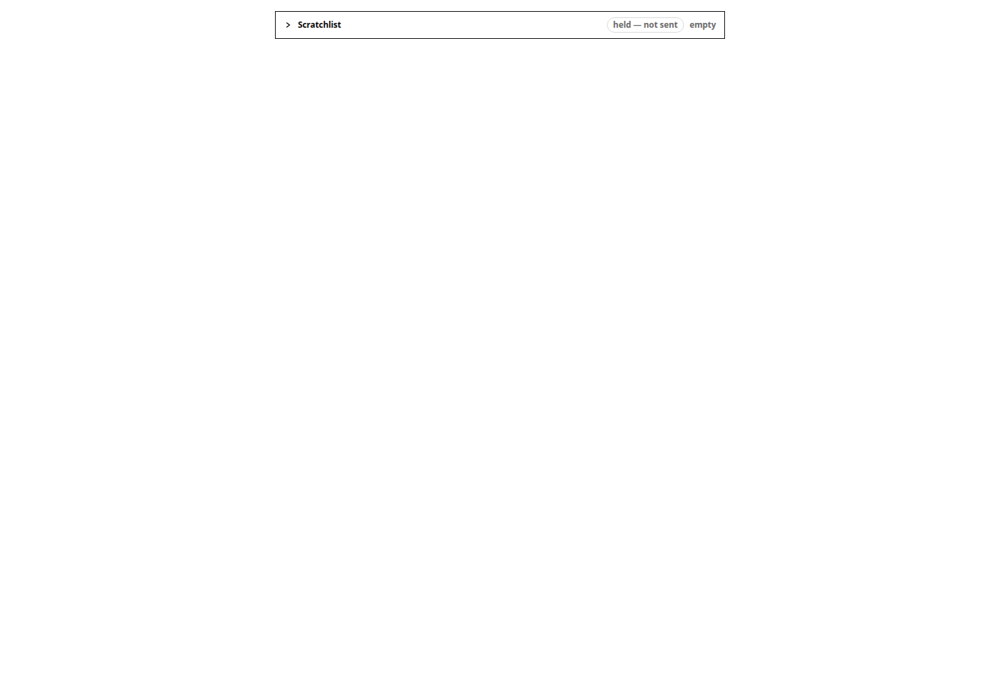

# Scratchlist and message queue

[English](./scratchlist.md) · [简体中文](../scratchlist.md) · [Feature directory](index.md)

Use the scratchlist to hold notes. Use the message queue for messages intended for the agent.

## Add, reorder and remove notes

1. Open Scratchlist from the composer. `Ctrl/Cmd+Shift+S` focuses the add-note input.
2. Write an item and add it to the list.
3. Reorder items using the move or drag controls provided.
4. Delete entries you no longer need.

Each session has its own list. Seeing a different list after switching sessions is expected. A saved scratchlist item has not necessarily been sent to the agent.

## Move a note to the composer or queue

| Entry | Action | Verify |
| --- | --- | --- |
| Promote to composer | Select the item's composer action | The text appears for editing before you send it |
| Promote to queue | Select the queue action | Inspect the queue or delivery status; a click alone is not confirmation |
| Edit or remove a queued message | Use the action on that message | Confirm the new content or removal |

If sending fails, read the error before retrying. Avoid repeated clicks. See [Scheduled messages](schedules.md#message) to send at a later time.

## Interface and behavior references

`web/src/components/AssistantChat/ScratchlistPanel.tsx`, `web/src/components/SessionChat.tsx`. Screenshots use production components with synthetic data. They do not show operations being executed on a real machine.
