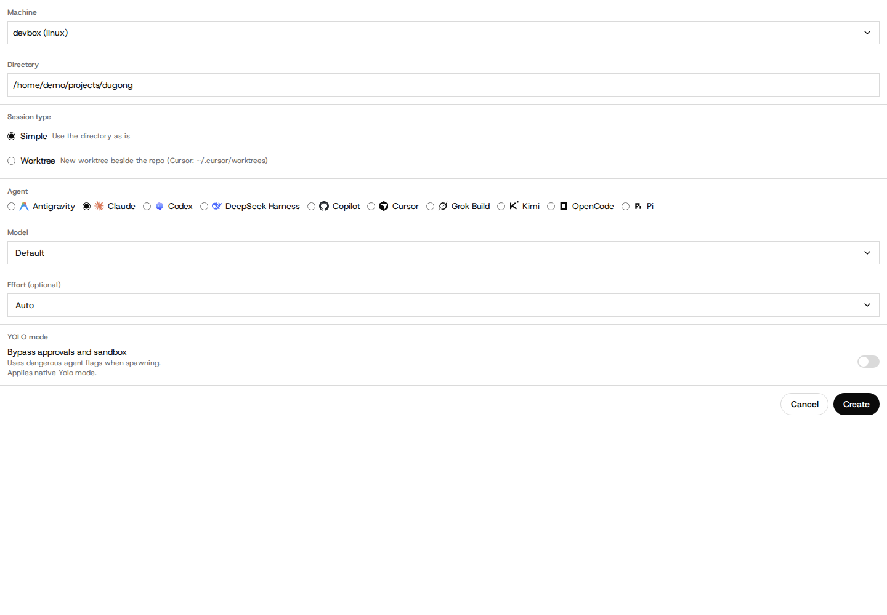
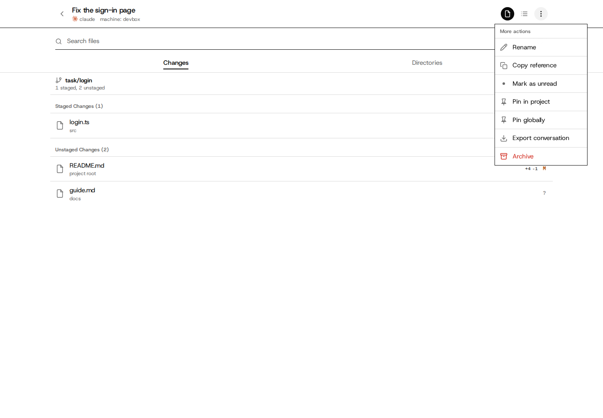

# Create and manage sessions

[English](./sessions.md) · [简体中文](../sessions.md) · [Feature directory](index.md)

Enter a conversation through its task when possible. Standalone sessions are also available. Options vary with the agent and runner version.

## Create a standalone session

1. Open the new-session screen and choose a machine and directory.
2. Choose Simple or Worktree mode and an agent.
3. Set the model, reasoning effort, permissions and other fields shown for that agent.
4. Create the session, then send your first message.

If the machine says it needs an update, upgrade its runner first. Selecting an option in the browser cannot enable a capability the machine does not support.

## Switch sessions and resume work

1. Select the conversation in the task or session list.
2. Check the machine, path and agent below its title before sending anything.
3. If the session is inactive, use the resume or reopen action offered by the interface. Support depends on the agent and machine.
4. If a new session supersedes the old one, continue in the current session the interface opens.

Reading stored messages usually does not require a running agent. Continuing work, reading files and using the terminal may require an online connection.

## Use the session menu

Open the menu beside the session title. Check the title before applying an action.

| Action | Steps | Result |
| --- | --- | --- |
| Rename | Edit the title and save | Changes the display name, not the disk directory |
| Export conversation | Open the dialog, select a format and download | Saves the conversation rather than a single-turn image |
| Copy reference | Copy, then paste into another conversation | Includes information identifying this session |
| Mark unread | Select the menu item | Marks the conversation for later reading |
| Project or global pin | Choose a pin scope; use the menu to undo it | Changes where the session is prioritized |
| Sync Codex or Pi | Use the item when offered for that agent | Synchronizes supported local history; availability depends on session state |
| Archive or delete | Read and confirm the offered action | Changes session records or visibility; does not roll back Git |

Menu items depend on the session state and environment. Export conversations you need before deleting them.

## Interface and behavior references

`web/src/components/NewSession/index.tsx`, `web/src/components/SessionHeader.tsx`. Screenshots use production components with synthetic data. They do not show operations being executed on a real machine.
