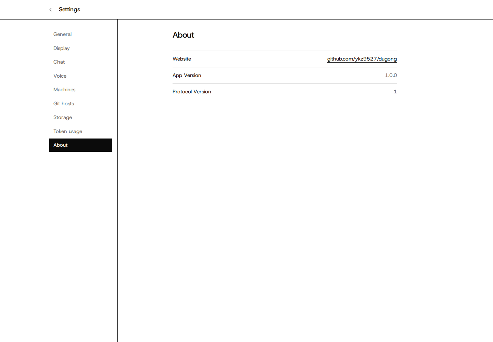

# Settings: versions and project links

[English](./settings-about.md) · [简体中文](../settings-about.md) · [Feature directory](index.md)

Record CLI, hub and web versions before troubleshooting so you do not mix behavior from different versions.

## Check versions and open the project

1. Open Settings → About.
2. Record the application and protocol versions.
3. Follow the project link to the repository for releases, documentation and issues.
4. When reporting a problem, include the version, device type, reproduction steps and sanitized screenshots.

These screenshots come from a documentation environment and may show the unreleased 1.0.0 version. Check [Releases](https://github.com/ykz9527/dugong/releases) and npm for installable versions.

## Interface and behavior references

`web/src/routes/settings/about.tsx`. Screenshots use production components with synthetic data. They do not show operations being executed on a real machine.
