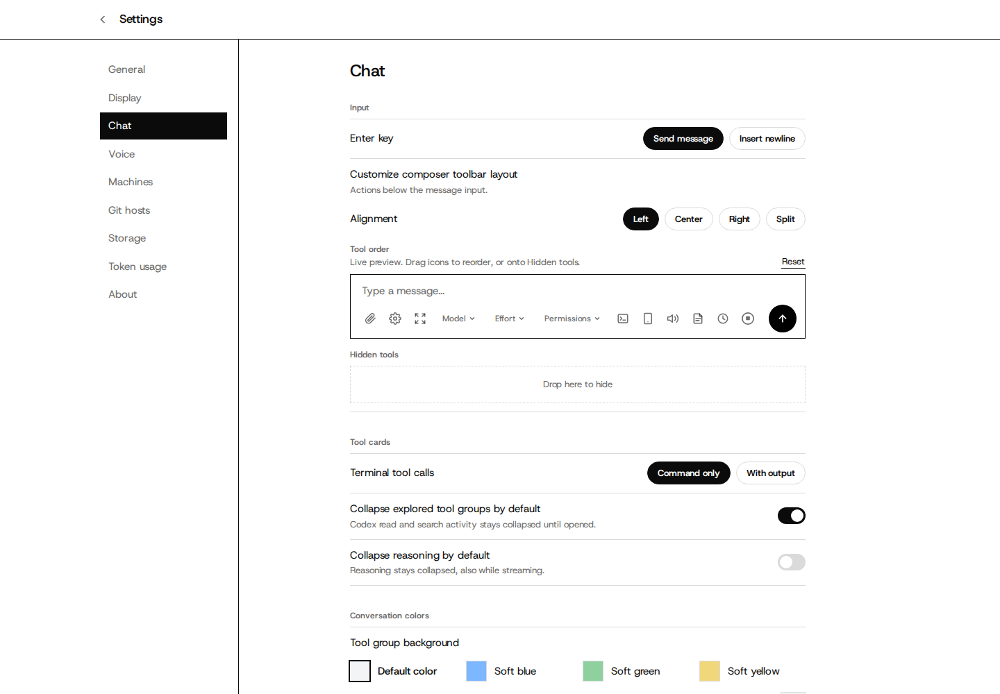
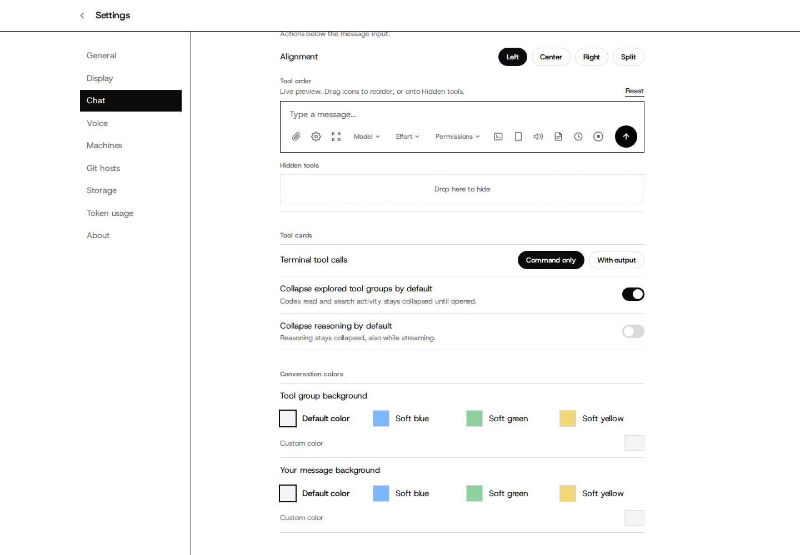

# Settings: input behavior and toolbar

[English](./settings-chat.md) · [简体中文](../settings-chat.md) · [Feature directory](index.md)

Open Settings → Chat. Restore hidden controls here instead of reinstalling the application.

## Choose what Enter does

1. Find Enter key behavior.
2. Choose Send message or Insert newline.
3. Try a short draft in the composer to confirm the behavior.

Use the explicit Send button when unsure of the shortcut, especially for a long draft.

## Arrange and hide composer tools

1. Choose left, center, right or split alignment.
2. Drag icons to reorder them. Split alignment allows moving tools between groups.
3. Drag an infrequently used tool to Hidden tools, or use its Hide action.
4. Restore it from the hidden area, or reset the whole toolbar to defaults.

Tools include attachments, session settings, the expanded editor, model, effort, permissions, terminal, abort, remote-mode switching, microphone, scratchlist and scheduling. Agent support and session state still determine which tools can be used.

## Customize tool cards and conversation colors

1. Choose the command-only or full presentation offered for terminal tool cards.
2. Set the default collapse behavior for exploration tools and reasoning output.
3. Choose backgrounds for user messages, tool cards and grouped tool activity. Use custom colors or reset them as needed.

Collapsing a card changes its presentation; it does not delete the message. Expand a card to inspect the execution details.

## Interface and behavior references

`web/src/routes/settings/chat.tsx`, `web/src/components/settings/ComposerToolbarLayoutControl.tsx`. Screenshots use production components with synthetic data. They do not show operations being executed on a real machine.
