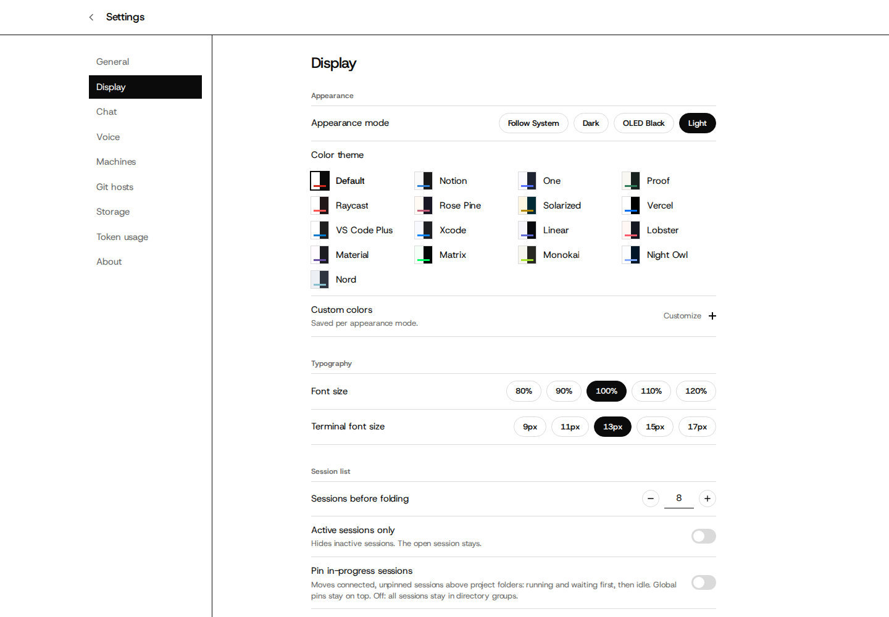
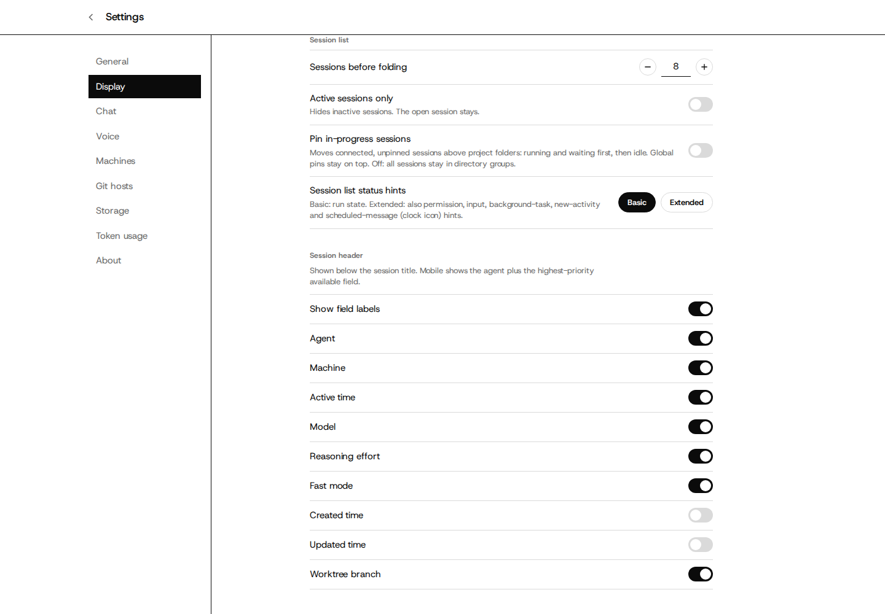

# Settings: appearance, fonts and session display

[English](./settings-display.md) · [简体中文](../settings-display.md) · [Feature directory](index.md)

These controls change the interface, not project files. Scroll down to find session-header fields and custom color options.

## Choose appearance and colors

1. Open Settings → Display.
2. Choose Follow System, Dark, OLED Black or Light.
3. Select a color theme and inspect the live result.
4. Expand Custom colors to adjust individual colors. Restore one value or all values when needed.

Custom colors are saved per appearance mode. Check which mode you are editing when switching between light and dark.

## Adjust interface and terminal font sizes

1. Choose an interface font size in Typography.
2. Choose the terminal font size separately.
3. Return to a long conversation or terminal to check readability and wrapping.

The two font sizes are independent. Larger text reduces how much fits on a screen.

## Customize session lists and headers

| Control | Action | Result |
| --- | --- | --- |
| Sessions before folding | Use the minus and plus controls | Changes how many sessions appear before a group folds |
| Active sessions only | Enable or disable | Filters the list without deleting history |
| Pin in-progress sessions | Enable or disable | Prioritizes sessions with work in progress |
| Session list status | Choose a display style | Changes the amount of status detail |
| Session-header fields | Toggle machine, model, effort, times, worktree and other fields | Chooses information below the title |
| Field labels | Enable or disable | Changes how field names and values appear |

Phones have less header space and show a subset of priority fields. Task status groups and session-list preferences are separate layouts.

## Interface and behavior references

`web/src/routes/settings/display.tsx`. Screenshots use production components with synthetic data. They do not show operations being executed on a real machine.
