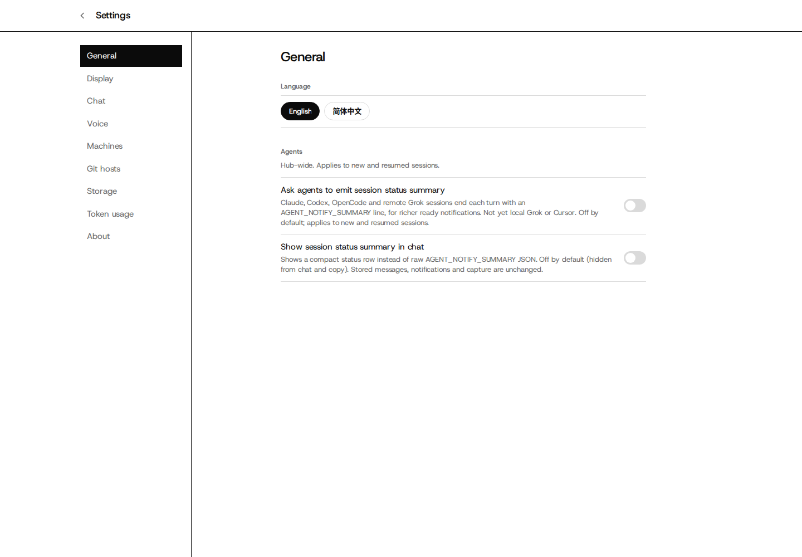

# Settings: language and session summaries

[English](./settings-general.md) · [简体中文](../settings-general.md) · [Feature directory](index.md)

Open Settings → General. Language and some display preferences belong to the current browser; hub-level switches affect newly created or resumed sessions.

## Change the interface language

1. Open Settings → General.
2. Under Language, choose English or 简体中文.
3. Return to the task view and check the labels.

Changing the interface language does not translate existing prompts, task titles or conversations.

## Configure session summaries

| Switch | How to use it | Scope |
| --- | --- | --- |
| Require session status summaries | Enable it, then inspect end-of-turn summaries in newly created or resumed sessions | Hub-level; supported agents and modes follow the convention |
| Show summaries in chat | Enable compact summary rows in the conversation | Display preference; does not change stored messages or notification collection |

Claude, Codex, OpenCode and remote Grok support the summary convention. Local Grok and Cursor currently do not. Changing the switch does not immediately reconfigure every session already running.

## Interface and behavior references

`web/src/routes/settings/general.tsx`. Screenshots use production components with synthetic data. They do not show operations being executed on a real machine.
