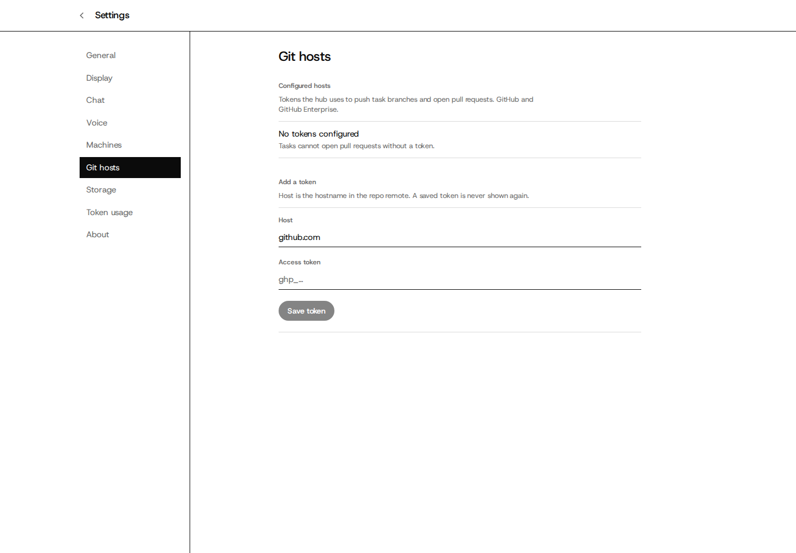

# Settings: Git hosting credentials

[English](./settings-git.md) · [简体中文](../settings-git.md) · [Feature directory](index.md)

These credentials are used by the hub for task-branch pushes and PR operations. They do not automatically replace every Git or SSH setting on the machine.

## Add a host and token

1. Open Settings → Git hosts.
2. Enter `github.com` or your GitHub Enterprise hostname.
3. Enter a token with the permissions needed for the target repository and save.
4. Return to task details and try Open PR. Use the result to diagnose remote or permission problems.

The host must match the repository remote. Enter a hostname, not a complete repository URL.

## Inspect, replace and remove credentials

1. Check hostnames and masked hints in the configured-host list.
2. To replace a token, enter the new value and save.
3. Remove a host using its deletion control when it is no longer needed.

Removing credentials can break dependent push or PR operations, but does not delete existing GitHub PRs. Saving a token does not prove that it can access every repository.

## Interface and behavior references

`web/src/routes/settings/git-host.tsx`. Screenshots use production components with synthetic data. They do not show operations being executed on a real machine.
