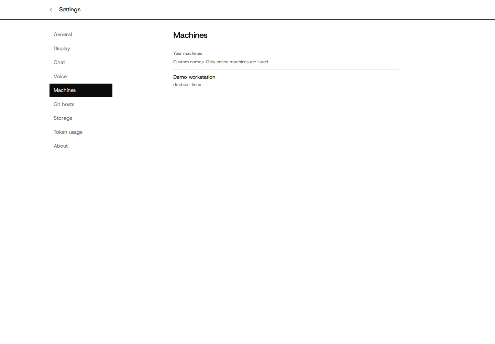
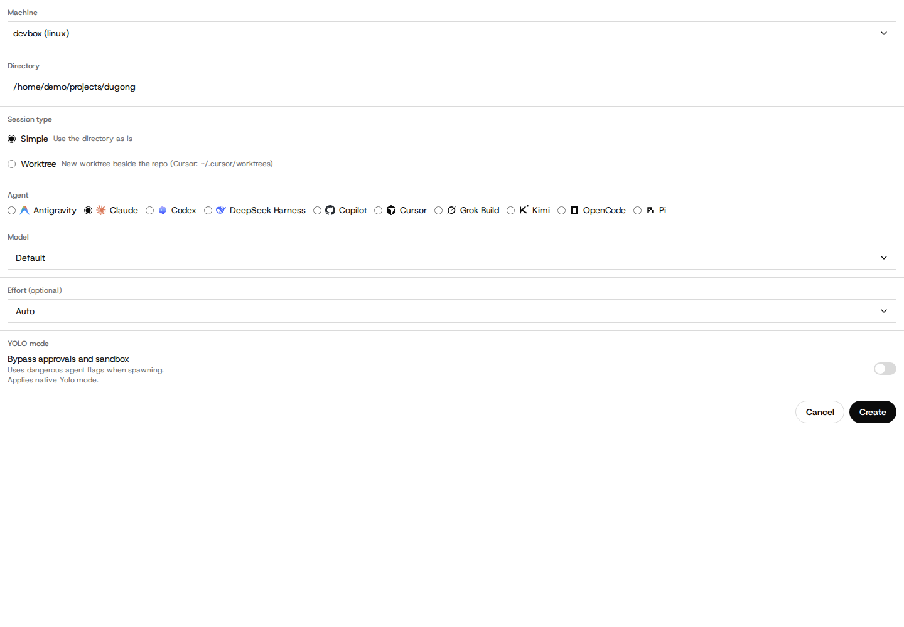

# Settings: machine names and connections

[English](./settings-machines.md) · [简体中文](../settings-machines.md) · [Feature directory](index.md)

Use Settings to identify online machines. Start and authenticate the runner in a terminal on the execution machine.

## View and rename a machine

1. Open Settings → Machines.
2. Check the hostname and operating system of an online machine.
3. Use the name-editing control, enter a recognizable name and save.
4. Verify the name in the new-task form.

This changes dugong's display name, not the operating-system hostname. Only online machines are listed. If one disappears, check its runner before trying to recreate it.

## Troubleshoot a missing machine

1. On the target machine, check `dugong --version` and that the agent CLI works.
2. Verify that the runner uses the same hub address and credentials as the web interface.
3. Start `dugong runner start --workspace-root /path/to/projects`.
4. Return to Machines or the task form and wait for the connection state to update.

If the machine is online but folders cannot be browsed, check workspace roots. If it requires an update, upgrade the CLI and restart that machine's runner.

## Interface and behavior references

`web/src/routes/settings/machines.tsx`, `cli/README.md`. Screenshots use production components with synthetic data. They do not show operations being executed on a real machine.
