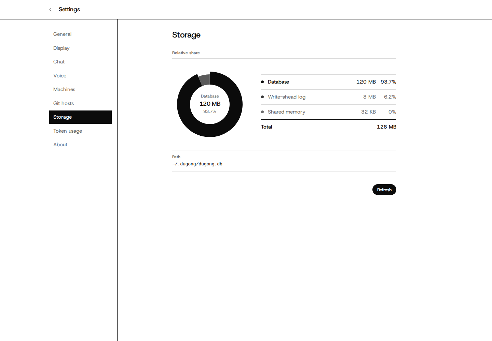

# Settings: storage usage

[English](./settings-storage.md) · [简体中文](../settings-storage.md) · [Feature directory](index.md)

Storage shows the hub's SQLite file usage, not the disk space used by all projects. This entry is for the hub owner.

## Inspect database, WAL and shared-memory files

1. Open Settings → Storage.
2. Check the database path, total size and proportions.
3. Click Refresh to read the current sizes.

| Item | Meaning |
| --- | --- |
| Database | The persistent database file |
| Write-ahead log (WAL) | SQLite's write-ahead log |
| Shared memory (SHM) | SQLite's shared-memory index file |

This page does not provide a one-click database wipe. Do not delete an active WAL or SHM file to reclaim space. Back up and stop the service according to your maintenance procedure first.

## Interface and behavior references

`web/src/routes/settings/storage.tsx`. Screenshots use production components with synthetic data. They do not show operations being executed on a real machine.
