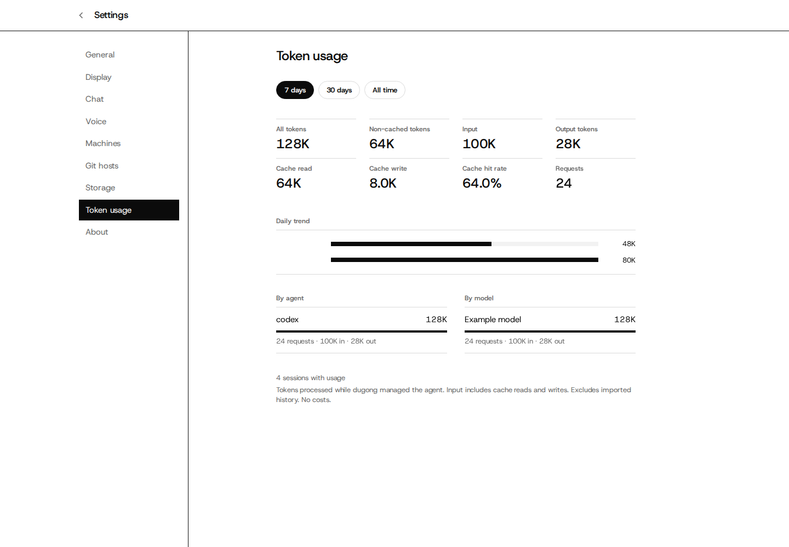

# Settings: token usage

[English](./settings-usage.md) · [简体中文](../settings-usage.md) · [Feature directory](index.md)

Usage summarizes events collected by the hub for its owner. It is not the provider's final invoice.

## Choose a time range

1. Open Settings → Token usage.
2. Choose the last 7 days, last 30 days or all time.
3. Check the totals and daily chart against your selected range.

The page requests totals using the browser's time zone. If no records appear, verify that supported usage events have been collected.

## Read cache and source breakdowns

| Metric or section | What it shows |
| --- | --- |
| Total tokens | Usage within the selected range |
| Input and output | Context received and model output generated |
| Cache reads and creation | Cache-related usage |
| Uncached tokens | The separately reported non-cache portion |
| Requests and sessions | The scale of activity included |
| By agent and model | Usage grouped by its source |

Reporting capabilities vary by agent. Multiplying the total by one universal price does not produce an accurate bill.

## Interface and behavior references

`web/src/routes/settings/usage.tsx`. Screenshots use production components with synthetic data. They do not show operations being executed on a real machine.
