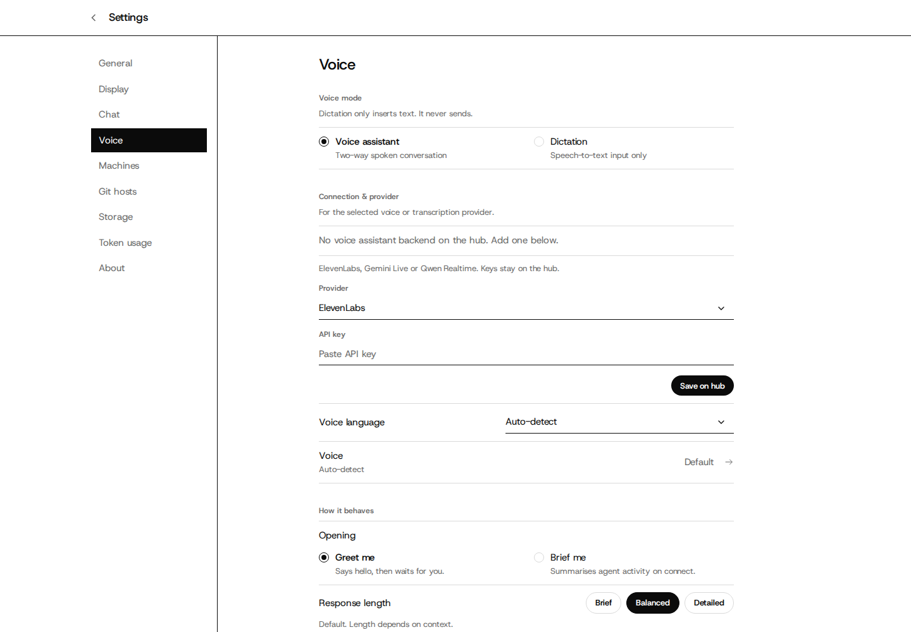
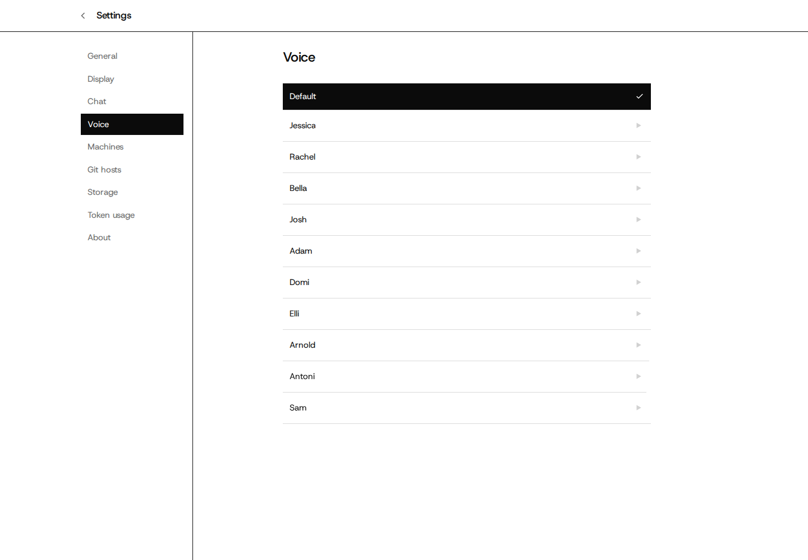
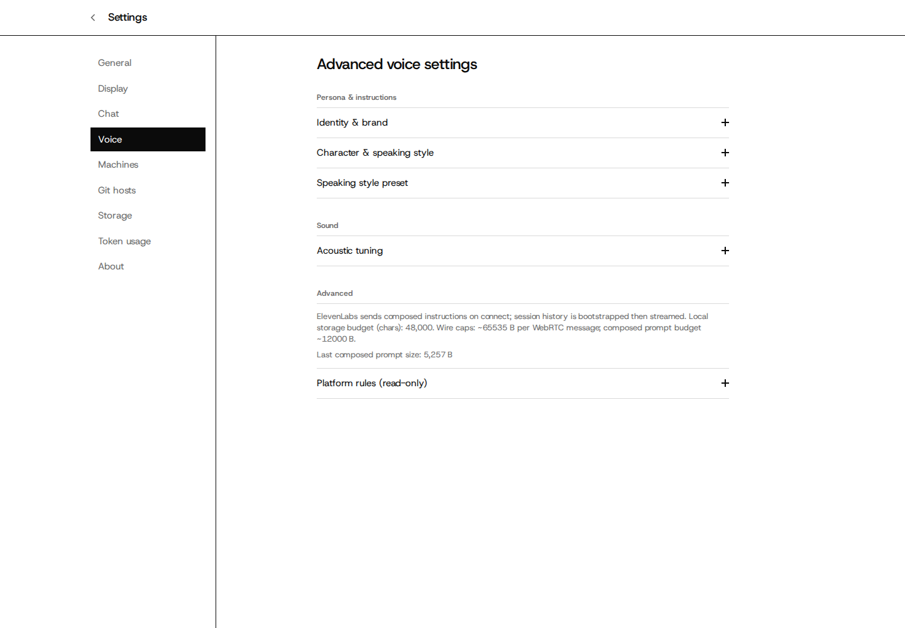

# Settings: dictation and voice assistant

[English](./settings-voice.md) · [简体中文](../settings-voice.md) · [Feature directory](index.md)

Dictation inserts transcribed text into the composer. The voice assistant supports a two-way spoken conversation. Screenshots show an unconfigured backend; available services depend on your hub configuration.

## Choose a voice mode and connect

1. Open Settings → Voice.
2. Choose dictation or the voice assistant.
3. Choose an available service and input mode, then use the microphone control in the session.
4. Grant browser microphone access when asked. After dictation, review the text and send it yourself.

Dictation does not automatically send a message. If no service is available, configure credentials first. HTTPS, a working microphone and browser permission are also required.

## Configure voice service credentials

1. Open the connection or service configuration area in Voice settings.
2. Select the transcription or voice backend and fill in its required credentials and endpoint.
3. Save, confirm that it is shown as configured, and try a short utterance.

Credentials supplied through environment variables may be read-only. Follow each field's explanation. Screenshots should show only masked values or credential sources, never actual secrets. Providers determine their own authentication and billing.

## Choose and preview a voice

1. Open Voices from the voice settings.
2. Select a voice using the backend, language or search controls offered.
3. Preview it, then choose the voice you want.
4. Return to the session and try a short conversation.

Availability depends on the configured backend. Default voices may be listed even when speech synthesis has not been configured.

## Adjust persona, delivery and diagnostics

1. Open Advanced voice settings.
2. Expand the identity, personality, speaking style, sound effects or voice-tuning groups you need.
3. Change one group at a time and test it in a conversation.
4. Inspect diagnostics when connection fails; restore defaults before retesting the basic connection.

Advanced controls are not shared by every backend. Follow the support notes on the page. Voice persona instructions do not replace the coding agent's permission controls.

## Interface and behavior references

`web/src/routes/settings/voice.tsx`, `web/src/routes/settings/voice-voices.tsx`, `web/src/routes/settings/voice-advanced.tsx`. Screenshots use production components with synthetic data. They do not show operations being executed on a real machine.
