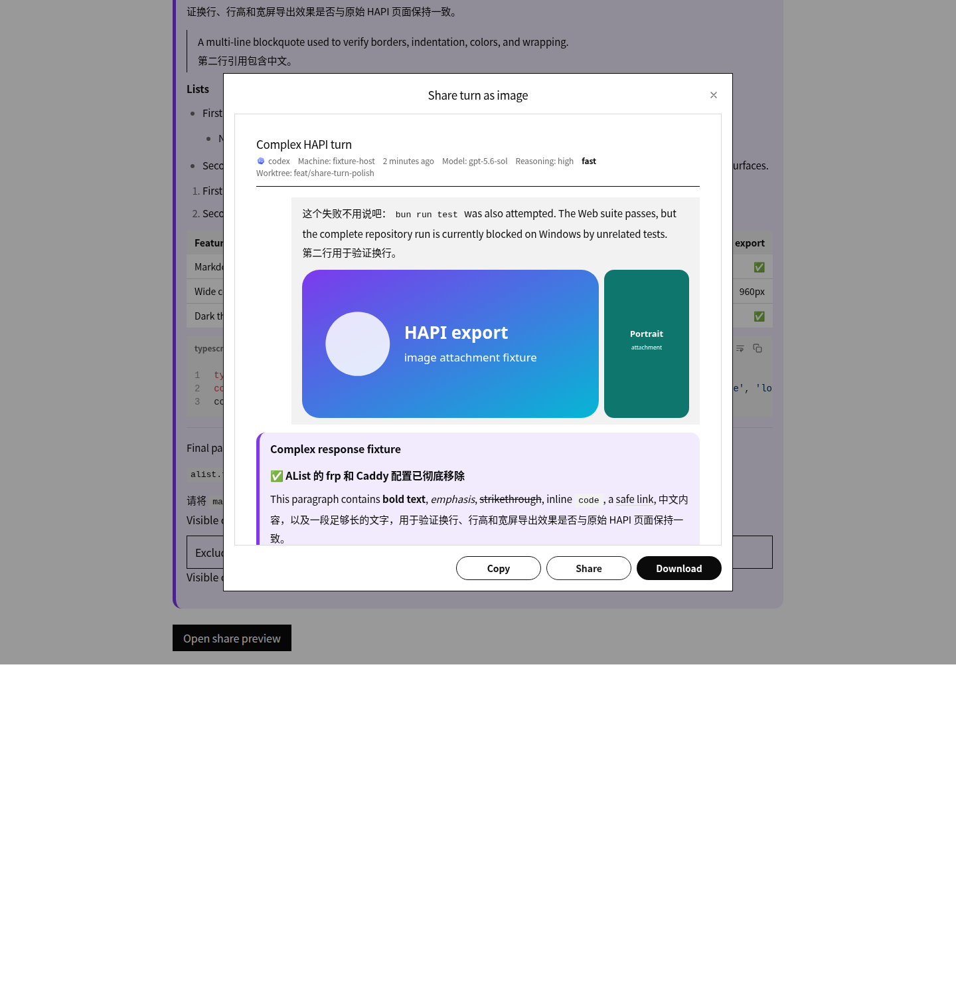
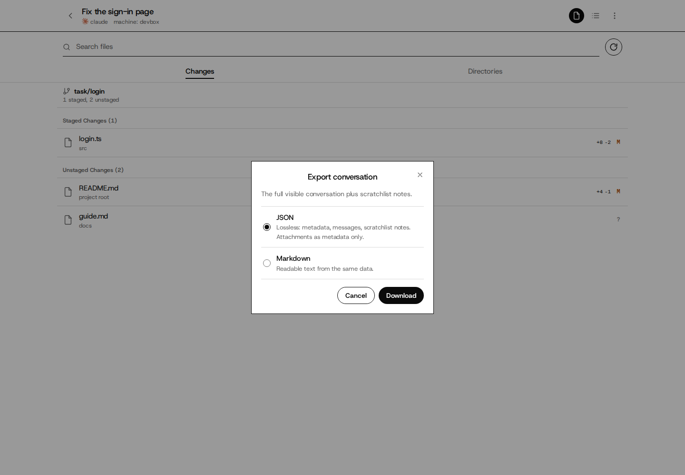

# Copy, export and share images

[English](./sharing.md) · [简体中文](../sharing.md) · [Feature directory](index.md)

Copy short excerpts, share an image of a turn, or export an entire conversation.

## Share a conversation turn as an image

1. Find the turn you want and click Share turn as image.
2. Review the text, code and images included in the preview.
3. Choose Copy, Download or Share, depending on browser support.
4. Before sending it to someone else, check for private paths, credentials or sensitive conversation content.

The preview handles some tool output and controls differently from a raw screenshot. Review the preview and exported image rather than assuming everything visible in chat is included.

## Export a whole conversation

1. Open Export conversation from the session menu.
2. Select JSON or Markdown. JSON includes metadata, messages and scratchlist notes; Markdown is a readable view of the same data. Attachments include metadata only.
3. Generate the export, wait for completion and download it.
4. Open the file to verify its title, timestamps and content range.

If clipboard or system sharing is unavailable, use Download. A turn image and a conversation export serve different purposes.

## Interface and behavior references

`web/src/components/AssistantChat/ShareTurnDialog.tsx`, `web/src/components/SessionHeader.tsx`. Screenshots use production components with synthetic data. They do not show operations being executed on a real machine.
