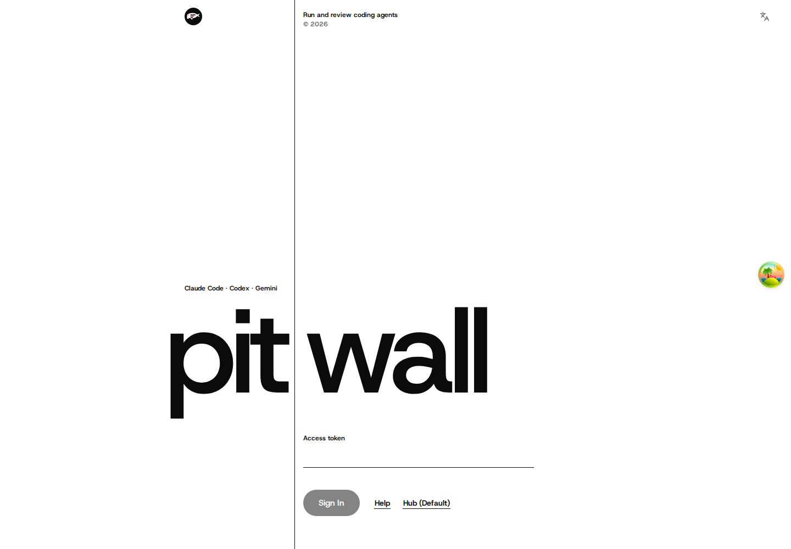
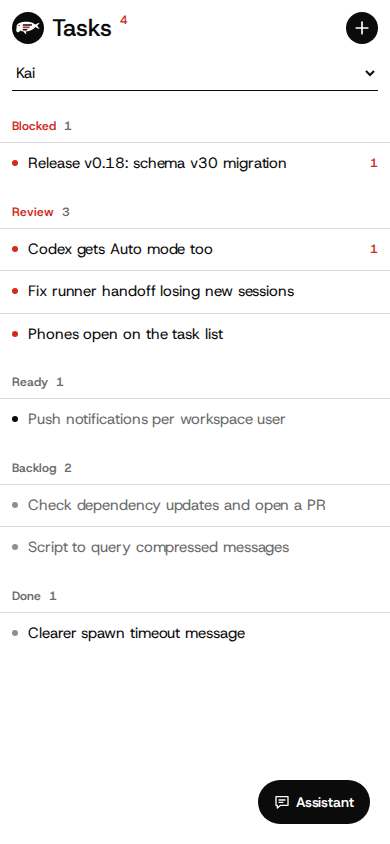

# Getting started and navigation

[English](./start.md) · [简体中文](../start.md) · [Feature directory](index.md)

Connect to your hub, then connect the machine that will run your agents. This manual describes the interface following the 0.30.0 release. Version 1.0.0 has not been released; a development version shown in a screenshot is not a release announcement.

## Connect and sign in

1. Open your hub address. The default is `http://localhost:3006`. If your administrator changed the port, use that address, for example `http://10.176.37.2:3008`.
2. Check the selected hub on the sign-in page and enter the access token supplied by your administrator. The screenshot contains no usable credentials.
3. After signing in, select a task to open its conversation.

For a new installation, run `npm install -g @ykz9527/dugong`. Start `dugong hub` and `dugong runner start --workspace-root ~/code` in separate terminals. Install and sign in to your agent CLI on the execution machine as well.

The sign-in screen may still show the old name, pitwall. Confirm the hub address you deployed. Your access token authenticates you; choosing a workspace user does not replace authentication.

## Find your way around the desktop

| Where to click | Action | Result |
| --- | --- | --- |
| Task title in the sidebar | Select a task | Its conversation opens in the center |
| Details on a task row | Hover over the row, then click | View the prompt, status, directory, PR, schedule and run history |
| Plus button | Create a task | Open the task form |
| User picker | Choose everyone or a user | Filter tasks by that user's directory scope |
| Task assistant button | Open or close the assistant | Show or hide the assistant panel |

On desktop, tasks, a conversation and the assistant can appear side by side. Phones use separate views or overlay panels.

## Use dugong on your phone

1. Open a hub address reachable from your phone. A local network address requires a reachable network connection to the server.
2. Tap a task to enter its conversation. Use Back to return to the list.
3. Choose Add to Home Screen or Install app in your browser. The name depends on your device and browser.
4. For remote access, your administrator can run `dugong hub --relay` and share the HTTPS address it prints.

The default relay is operated by upstream HAPI. For your own network entry point, see [Deployment](../../guide/deployment.md). Notifications, microphone access and clipboard operations depend on HTTPS, browser support and system permissions.

## Interface and behavior references

`README.md`, `web/src/router.tsx`, `web/src/hooks/useAuth.ts`. Screenshots use production components with synthetic data. They do not show operations being executed on a real machine.
