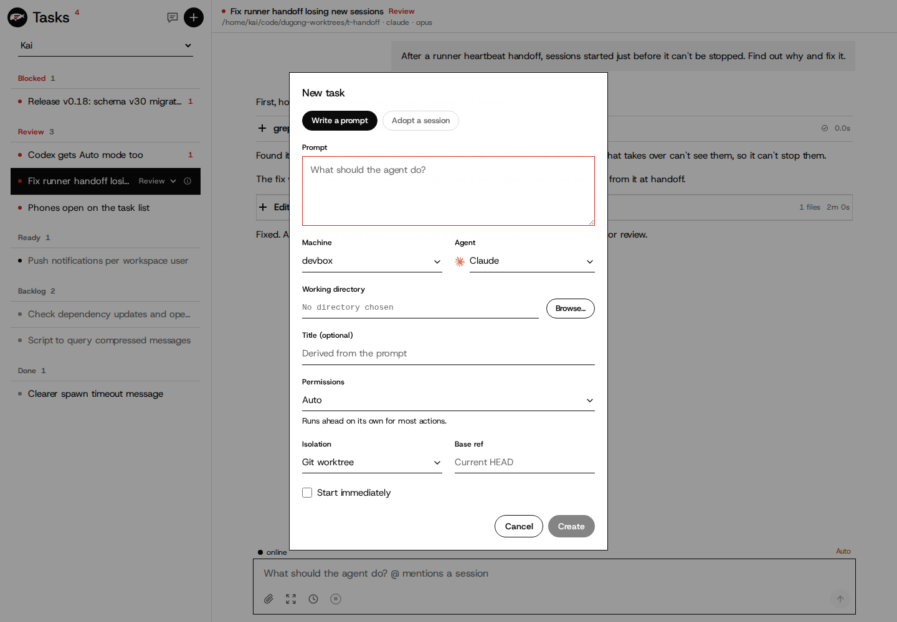
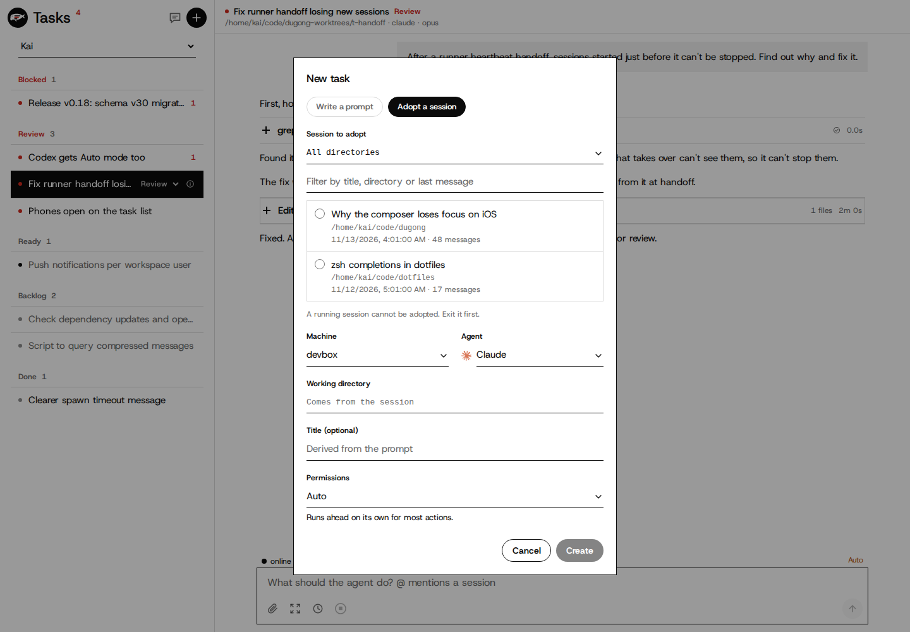
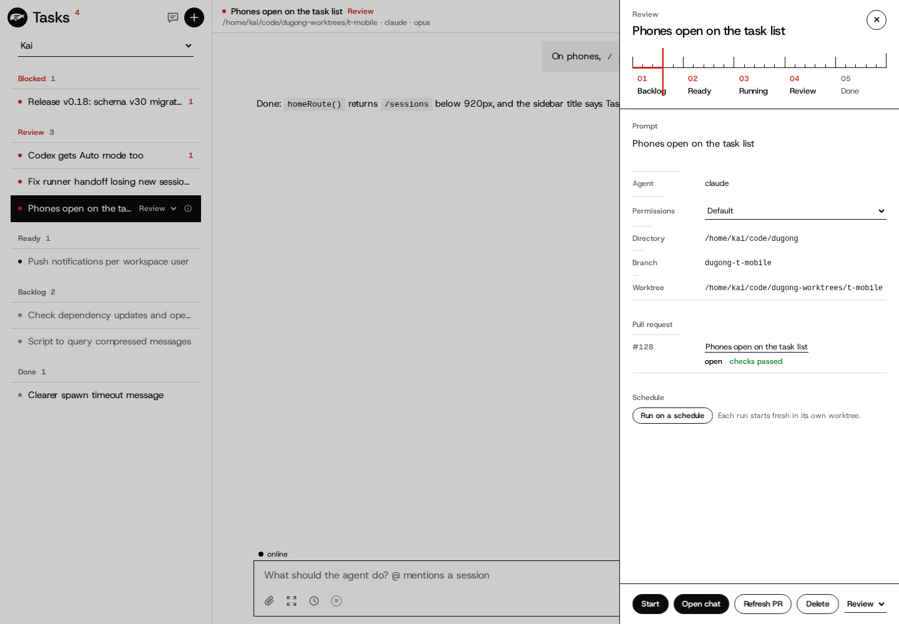
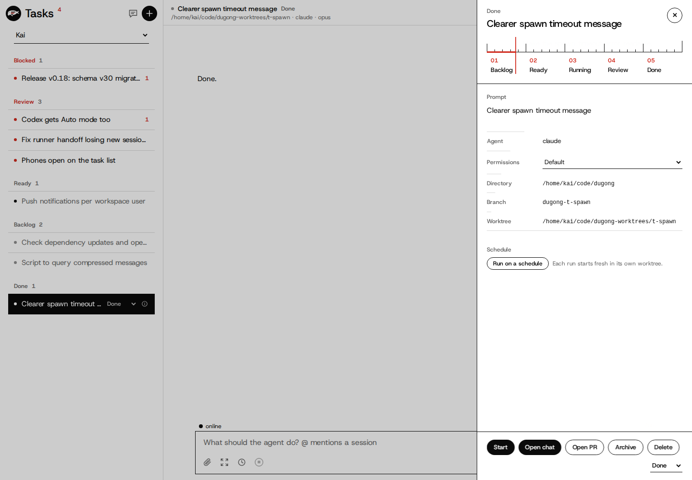

# Tasks, status and lifecycle

[English](./tasks.md) · [简体中文](../tasks.md) · [Feature directory](index.md)

A task records a goal, execution machine, directory and agent. A session holds the conversation. Create a task, then use its details to start or continue work.

## Browse and filter tasks

1. Review the status groups in the sidebar. Check Blocked and Review tasks first.
2. Click a task with a session to read its latest messages. For a task without a session, open Details to start it.
3. Use the user picker to change the visible scope. If a task seems missing, check the selected user and archived tasks.

| Status | Meaning | What to do |
| --- | --- | --- |
| Backlog | Not started | Complete the prompt, then start |
| Ready | Stopped, or available to retry after an ordinary failure | Read the last run before restarting |
| Running | The agent or tracked background work is active | Watch output; stop if needed |
| Blocked | A session, runner or prompt-delivery dependency failed | Read the error, restore the environment, then retry |
| Review | A turn ended, or the agent needs approval or an answer | Review, approve or clarify |
| Done | You accepted the result | Check the deliverables, then archive |

Status describes execution progress. It does not prove that tests passed or code was merged.

## Create a task

1. Click the plus button above the task list.
2. Write the goal, constraints and acceptance criteria in the prompt, such as “Fix Enter submission on the sign-in page, add a test and report the result.”
3. Choose the machine and agent. Click Browse to select a working directory, or enter a path where the form supports it.
4. Select permissions and isolation. Set a base ref if needed.
5. Optionally supply a short title, choose whether to start immediately, then click Create.

| Field | Choose | Effect |
| --- | --- | --- |
| Machine | An online runner | Determines where code runs |
| Working directory | Your project directory | A remote path, not a phone directory |
| Agent | An installed, authenticated CLI | Determines which agent runs |
| Permissions | Start with the smallest useful scope | Determines which operations require approval |
| Worktree | For parallel work in a Git repository | Gives the task a separate directory and branch |
| Simple | To use the original directory directly | Multiple tasks may modify the same files |
| Base ref | An existing branch or commit | Sets the starting point for the worktree |

If no machines appear, check the runner's hub connection. Directory browsing is limited by the runner's `--workspace-root` configuration.

## Adopt an existing session

1. Open New task and switch the source to Adopt a session.
2. Choose a machine and select a conversation from its supported import or adoption list.
3. Check the original directory and title, then create the task.
4. Open the session from task details to continue.

An adopted task's opening conversation text is descriptive. Starting it continues the original conversation without resending that text. Supported imports depend on the agent and machine capabilities.

## Start, stop and change status

1. Open task details and check the prompt and directory.
2. Click Start. A successful launch creates a run record and moves the task to Running.
3. To interrupt it, click Stop, then inspect the final output and run result.
4. After changing your requirements, start again or send a follow-up in the existing conversation.
5. Once you accept the work, choose Done from the status control.

Changing status does not validate code, create a Git commit, push a branch or merge a PR. Check the result shown after a stop request.

## Archive, restore and delete

| Entry | Steps | Result and limits |
| --- | --- | --- |
| Archive | Open details, click Archive and read the confirmation | Moves the task to archived tasks; an active task may need to stop first |
| Restore | Expand archived tasks, open details and restore | Returns the task to the active list |
| Delete | Click Delete, check the target and confirm | Removes the task record; use archive for routine organization |
| Uncommitted-change warning | Inspect the diff and preserve needed work first | Continuing is not an automatic backup |

Archiving a worktree task can include cleanup. If the interface says the session is still running, handle the remaining process even if the task has disappeared from the main list.

## Interface and behavior references

`web/src/components/Tasks/NewTaskDialog.tsx`, `web/src/components/Tasks/TaskDetail.tsx`, `web/src/components/Tasks/useTaskLifecycle.ts`. Screenshots use production components with synthetic data. They do not show operations being executed on a real machine.
