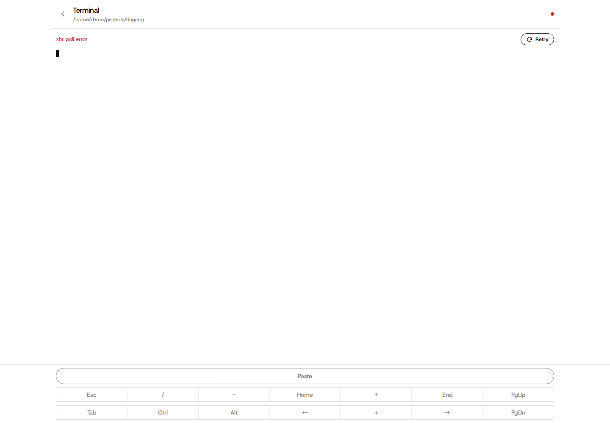
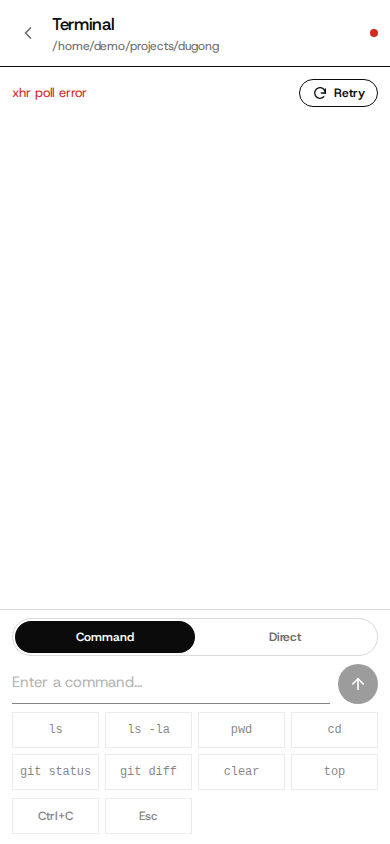

# Remote terminal and command input

[English](./terminal.md) · [简体中文](../terminal.md) · [Feature directory](index.md)

Terminal commands run on the execution machine, not on your phone. The machine and session connection must be available.

## Open the terminal and check its connection

1. Open the terminal from the session header or composer toolbar.
2. Verify the machine and directory, then wait for a ready connection.
3. If connection fails, use Retry and check the runner and hub.

Unsupported machines show a message. A tool-output card in chat is not an interactive terminal. This screenshot shows isolated connection controls without connecting to a real shell.

## Command mode, direct input and paste

| Control | How to use it | Result |
| --- | --- | --- |
| Command | Edit a command in the input, then execute it | Sends the complete command |
| Direct | Switch modes and enter keys directly | Supports interactive programs and shortcuts |
| Control, navigation, shell and symbols | Choose a mobile key category, then a key | Sends the key or combination |
| Paste | Grant clipboard access or use the fallback dialog | Inserts text into the terminal |

Command/direct modes and key categories mainly serve narrow screens. Desktop usually accepts direct terminal input. Check every command before running it: terminal operations affect the remote directory and are not approved through the agent's chat permission prompts.

## Interface and behavior references

`web/src/routes/sessions/terminal.tsx`. Screenshots use production components with synthetic data. They do not show operations being executed on a real machine.
