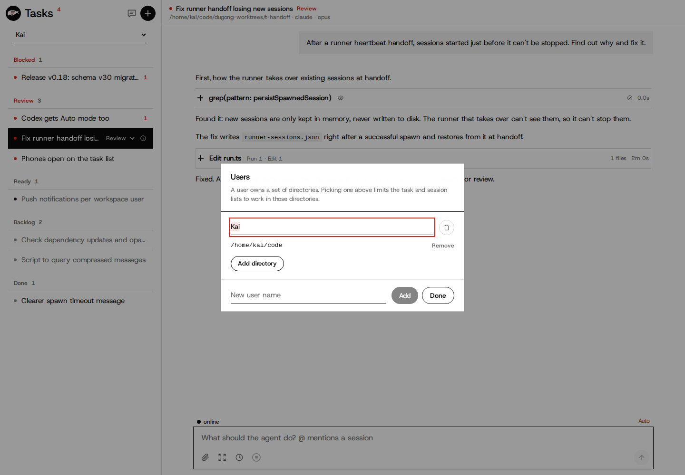

# Workspace users and directory scope

[English](./users.md) · [简体中文](../users.md) · [Feature directory](index.md)

Workspace users organize task visibility, personal assistants and related preferences. Namespaces are a separate layer that keeps work apart, but they are not access control: anyone with the base token can enter any namespace.

## Switch the selected user

1. Open the user picker above the task list.
2. Choose Everyone for tasks available to the current login, or select a user for their configured directory scope.
3. Before using the assistant, verify the selected user so you put memory in the intended place.

If a task is missing, check the user and directory settings before creating a duplicate.

## Add, rename and delete users

1. Select Manage users from the user picker.
2. Enter a new name and click Add.
3. Edit an existing name and save or finish as the dialog indicates.
4. Before deleting a user, check the target and complete the confirmation.

This manages the workspace view and assistant scope. It does not create an operating-system account.

## Configure a user's directories

1. Select a user in the management dialog.
2. Click Add directory, choose a machine and browse to the project root.
3. Remove an incorrect directory using its Remove action.
4. Return to the task list, select the user and verify that the intended tasks appear.

A user without directories may see no tasks. Browsing is also limited by the runner's workspace roots. Directory filtering is not a separate server security boundary; see [Namespaces](../../guide/namespace.md).

## Interface and behavior references

`web/src/components/WorkspaceUser/WorkspaceUserDialog.tsx`, `web/src/components/WorkspaceUser/WorkspaceUserPicker.tsx`. Screenshots use production components with synthetic data. They do not show operations being executed on a real machine.
