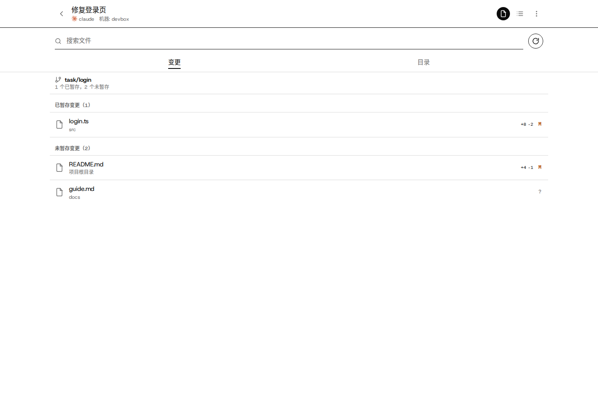
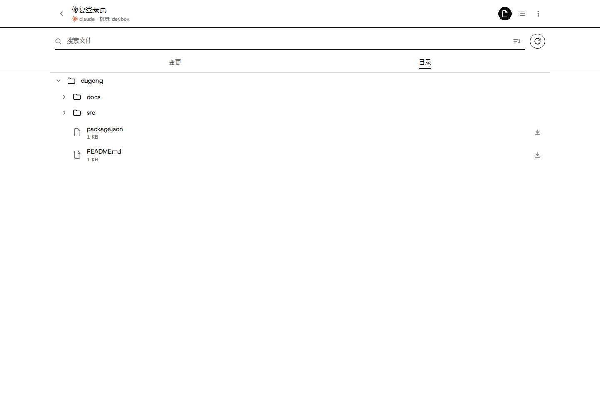
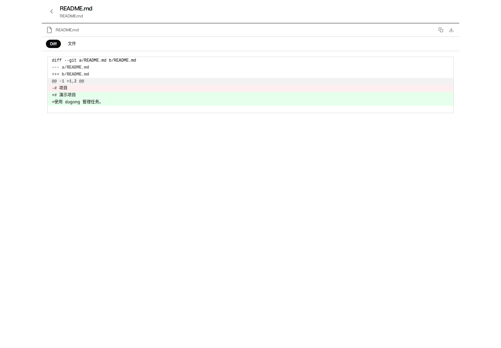

# 文件浏览、搜索与差异

[简体中文](files.md) · [English](en/files.md)

[返回功能目录](index.md)

从会话的文件入口检查实际项目文件；操作的是执行机器上的工作目录。

## 查看暂存与未暂存改动

1. 打开会话的文件视图，选择“改动”页签。
2. 区分已暂存、未暂存和未跟踪文件。
3. 点文件查看对应内容或 diff；核对路径和暂存标记。
4. agent 继续改动时，使用刷新入口获取最新状态。

文件列表反映 Git 工作区，不是“本次回答生成的文件清单”。简单模式下也可能包含其他任务或人工改动。

## 目录浏览、搜索和排序

1. 切换到目录页签，点目录进入，使用路径/返回入口回到上级。
2. 输入搜索条件，点匹配文件打开。
3. 使用界面提供的排序选项改变显示顺序。
4. 找不到文件时核对当前会话目录、机器在线状态及权限。

搜索结果与文件可读范围由当前工作目录和服务端能力决定。

## 阅读源码、Markdown 和 diff

1. 打开文件后查看路径，必要时复制路径。
2. Markdown 文件可切换“源码”和“预览”。
3. 从改动列表打开文件时，检查 staged/unstaged 对应的 diff。
4. 使用内容复制或下载入口保存需要的内容，返回文件列表继续查看。

这个页面主要用于查看。需要修改文件时，可在 agent 对话中提出改动，或在终端/本地编辑器操作；不要把预览当作已保存的编辑器。

## 界面与行为依据

`web/src/routes/sessions/files.tsx`、`web/src/routes/sessions/file.tsx`。截图使用真实组件和演示数据；不代表演示中操作已在真实机器执行。
