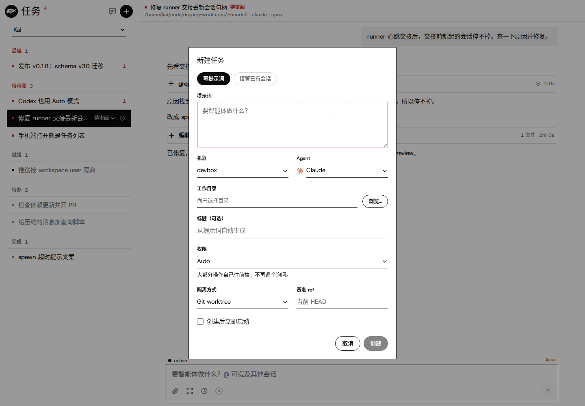
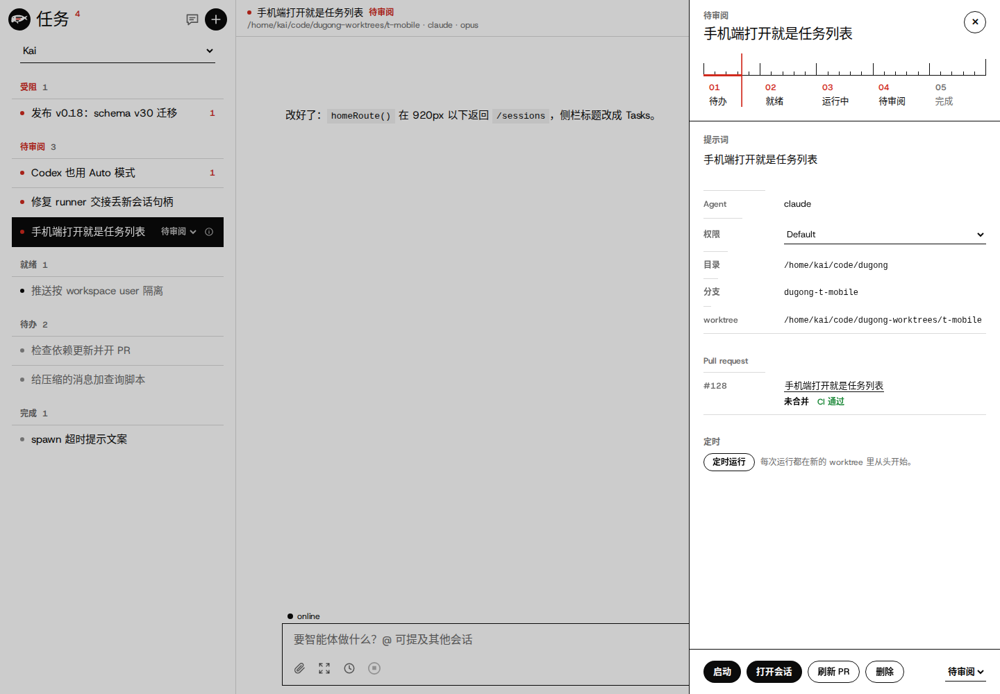

# worktree、分支与 PR

[简体中文](git.md) · [English](en/git.md)

[返回功能目录](index.md)

使用 worktree 隔离任务代码，在任务详情查看分支和 PR。

## 选择隔离方式

1. 创建任务时选择 worktree，并确认工作目录是 Git 仓库。
2. 填写需要的基准 ref；不确定时先确认仓库默认分支。
3. 启动后打开详情，查看“分支”和“worktree”实际值。

简单模式直接使用原目录。多人或多任务同时修改同一目录时，Git 状态会相互影响。worktree 隔离工作文件，但不会自动隔离数据库、端口或外部服务。

## 打开和刷新 PR

1. 在 agent 对话中完成代码、验证和需要的 commit。
2. 在任务详情核对分支、基准 ref 和改动。
3. 当“打开 PR”入口可用时点击，按返回结果打开代码托管页面。
4. 点击“刷新 PR”更新状态，查看检查结果、草稿标记和冲突提示。

需要可用的 Git remote、可推送分支及托管平台凭据。凭据设置见 [Git 托管](settings-git.md)。详情中的 PR 状态不替代代码平台的最终合并检查；这里没有承诺自动合并。

## 查看运行历史

1. 在任务详情向下找到“运行历史”。
2. 区分成功、失败、取消、被中断和超时。
3. 打开对应会话核对输出；同一任务多次运行时，不要把旧输出当作最新结果。

任务当前状态与历史某次运行结果是两项信息。定时任务还需要检查触发时刻和计划记录。

## 界面与行为依据

`web/src/components/Tasks/TaskDetail.tsx`、`web/src/components/Tasks/useTaskLifecycle.ts`。截图使用真实组件和演示数据；不代表演示中操作已在真实机器执行。
