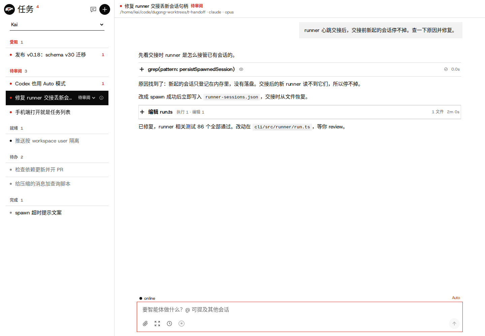

# 消息输入、附件与阅读

[简体中文](messages.md) · [English](en/messages.md)

[返回功能目录](index.md)

输入框控制本次会话；工具条可以在设置中调整，某个按钮不见时先检查隐藏工具。

## 输入、发送与中止

1. 在输入框写目标，点击“发送”。回车是否发送由聊天设置决定。
2. 长提示词可点“展开消息编辑器”，完成编辑后返回常规输入框。
3. agent 正在执行时，依据界面选择立即发送、排队或其他可用方式；各 agent 的支持不同。
4. 要停止当前执行，点击“中止”，等待状态更新。

中止不会自动撤销 agent 已写入的文件。发送后先看消息的投递状态，避免在连接不稳时重复提交相同任务。

## 添加附件、路径与引用

1. 点击“添加文件”，选择需要的图片或文件；在支持的输入框也可粘贴或拖入。
2. 检查附件名称和上传状态，再发送消息。
3. 使用输入框支持的 `@` 建议插入会话引用；发送前核对指向的是哪个会话。
4. 输入 `/` 时查看当前 agent 提供的命令建议；只使用当前列表支持的命令。

附件的读取能力取决于 agent。包含敏感数据的文件应先检查；文件名出现在输入框不代表已经完成上传。

## 模型、推理强度和权限

1. 点击输入栏的模型按钮，选择当前 agent 支持的模型。
2. 如有“推理强度”或快速模式选项，按任务需要选择。
3. 打开权限菜单，查看每个模式的说明后切换。

| 类型 | 决定什么 |
| --- | --- |
| 模型 | 使用哪个模型处理请求 |
| 推理强度 | 支持该能力的 agent 的推理档位 |
| 权限模式 | 工具执行是否需要人工确认 |
| 本地/远程控制 | 当前由终端还是网页进行交互 |

权限模式不是模型能力开关。不要仅为了少点按钮就放开所有操作。

## 查看工具结果、代码和历史

1. 点工具卡片展开命令、文件编辑或执行输出；再次点击可折叠。
2. 点消息旁“复制”保存文本；代码块也可能有独立复制按钮。
3. 图片、图表和 Markdown 链接按界面提供的预览入口打开。
4. 长对话使用大纲或历史滚动定位；未加载的历史不等于被删除。

当前发布候选的完整浏览器检查仍有历史滚动用例未通过，不把这份手册视为这些场景已通过验收的证明。

## 界面与行为依据

`web/src/components/AssistantChat/ComposerButtons.tsx`、`web/src/components/AssistantChat/HappyComposer.tsx`、`web/src/components/SessionHeader.tsx`。截图使用真实组件和演示数据；不代表演示中操作已在真实机器执行。
