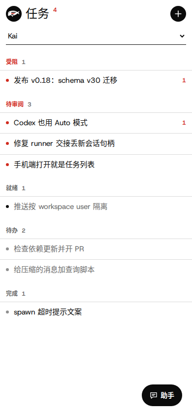

# 通知与离线使用

[简体中文](notifications.md) · [English](en/notifications.md)

[返回功能目录](index.md)

通知帮助你知道 agent 在等你；实际执行仍在 hub 和机器上进行。

## 启用浏览器通知

1. 使用自己的 HTTPS hub 地址打开网页，并按浏览器提供的安装入口添加到主屏幕。
2. 在应用/浏览器提供通知授权入口时允许通知。
3. 在系统设置中确认浏览器或 PWA 没被禁止通知。
4. 用一条可控的待审批任务检查能否收到提醒。

截图展示移动任务列表；系统通知授权弹窗随设备变化，不是固定的 dugong 按钮。通知不是实时执行状态的唯一依据，点开后应核对会话当前状态。

## 离线与多端使用

1. 断网时先查看离线提示，不要反复点发送。
2. 恢复网络后等列表和当前会话刷新。
3. 确认消息投递状态，再决定是否重发。
4. 在另一台设备访问相同 hub 时，使用正确的凭据和工作区用户。

安装 PWA 不等于把 agent 放在手机本机运行。通知渠道的服务器配置参见 [通知指南](../guide/notifications.md)。

## 界面与行为依据

`docs/guide/pwa.md`、`docs/guide/notifications.md`。截图使用真实组件和演示数据；不代表演示中操作已在真实机器执行。
