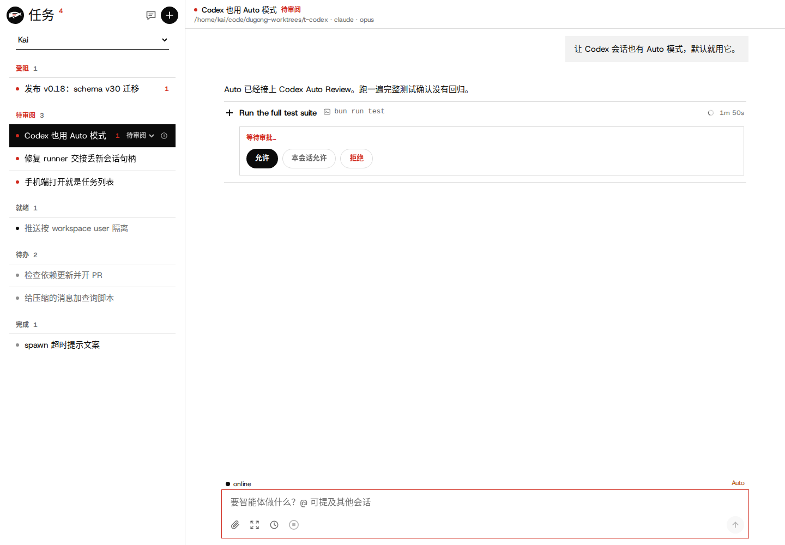
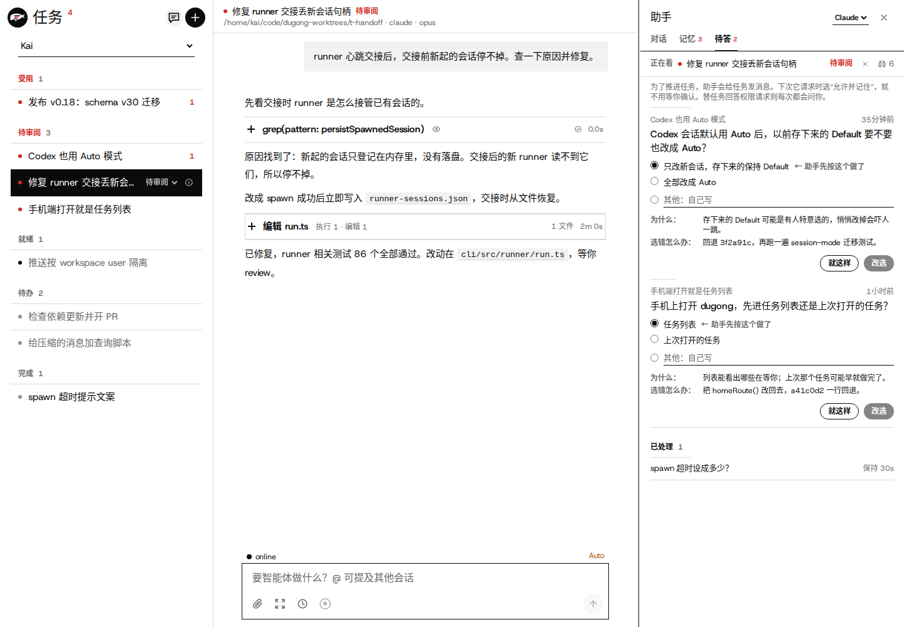

# 审批与回答问题

[返回功能目录](index.md)

agent 请求执行操作或需要选择时，会在会话内显示交互卡片。先看内容，再选操作。

## 批准或拒绝工具操作

1. 打开带有待审批提示的任务或会话。
2. 展开请求，阅读命令、参数、工作目录及相关文件路径。
3. 允许本次操作时点“允许”；不希望执行时点“拒绝”。
4. 只有希望后续同类操作免确认时，才使用当前界面提供的持续授权选项。
5. 等待卡片更新，再查看 agent 的后续输出。

任务详情中的批准快捷入口可能有“本会话内此工具不再询问”的范围说明，请按当前按钮旁的提示判断授权范围。

## 回答 agent 的选择题

会话中的选择题与助手的“待答”页是两个入口。会话卡片要求你选择选项或填写文本后提交；助手待答允许你确认或更改它先前采用的决定。

1. 阅读问题及选项说明。
2. 选择符合需求的选项，必要时补充自由文本。
3. 提交后确认卡片变为已处理。

本图展示助手待答页；[任务助手说明](assistant.md#questions)介绍它的“就这样”和“改选”。不要把关闭面板当作已经回答。

## 界面与行为依据

`web/src/components/ToolCard/PermissionFooter.tsx`、`web/src/components/ToolCard/AskUserQuestionFooter.tsx`、`web/src/components/Tasks/TaskDetail.tsx`。截图使用真实组件和演示数据；不代表演示中操作已在真实机器执行。
