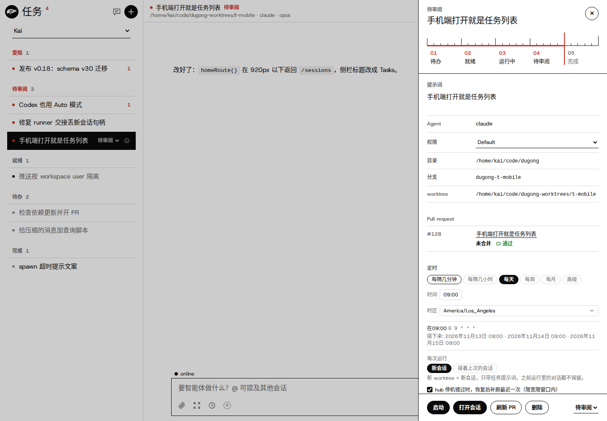
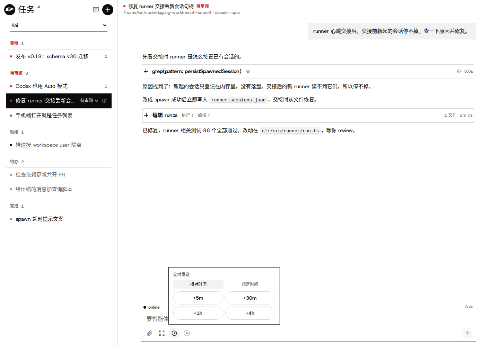

# 周期任务与定时消息

[简体中文](schedules.md) · [English](en/schedules.md)

[返回功能目录](index.md)

两种定时入口用途不同：任务详情的“定时运行”安排整个任务；输入栏的“定时发送”安排一条消息。

## 设置周期任务

1. 打开任务详情，点击“定时运行”。
2. 选择每隔几分钟、几小时、每天、每周或每月；高级模式填写五段 cron。
3. 选择时区，核对“接下来”显示的运行时刻。
4. 选择“新会话”或“接着上次的会话”。
5. 设置重叠策略、补跑和单次运行上限，保存。

| 选项 | 作用 |
| --- | --- |
| 新会话 | 新 worktree 与新会话，从任务提示词开始 |
| 接着上次的会话 | 尝试恢复上次会话与 worktree，并把提示词作为新一轮输入 |
| 跳过这次 | 上次未结束时跳过新触发 |
| 等它结束后跑一次 | 等待中的触发合并为一次，不是无限排队 |
| 补跑 | hub 恢复后，按宽限条件补最近一次错过的运行 |
| 单次运行上限 | 限制一次定时运行的最长时间 |

恢复失败可能回退到新会话，应检查运行记录。hub 需要在线，机器也必须能执行任务。

## 暂停、恢复和立即运行

1. 在已有计划旁点“立即运行”进行一次人工触发。
2. 不再自动触发时点“暂停”；需要继续时点“恢复”。
3. 点“编辑”修改时间规则，保存前再次检查时区和下次运行。
4. 删除计划时阅读确认提示；删除计划不等于删除任务。
5. 查看计划下方记录，区分 cron、人工触发、跳过、失败或超时。

若计划被自动暂停，先读失败原因并修复机器/agent 问题，再恢复，避免重复失败。

## 安排一条消息稍后发送

1. 在会话输入框写好要发送的消息。
2. 点击输入栏“定时发送”。
3. 选择未来的日期和时间，确认安排。
4. 在待发送区域核对时间；需要更改时先查看该条消息可用的编辑或取消操作。

最多安排未来 7 天。hub 需持续运行；CLI 离线时消息会在重连后收到。这个操作不会创建每日循环任务。

## 界面与行为依据

`web/src/components/Tasks/TaskScheduleSection.tsx`、`web/src/lib/locales/zh-CN.ts`。截图使用真实组件和演示数据；不代表演示中操作已在真实机器执行。
