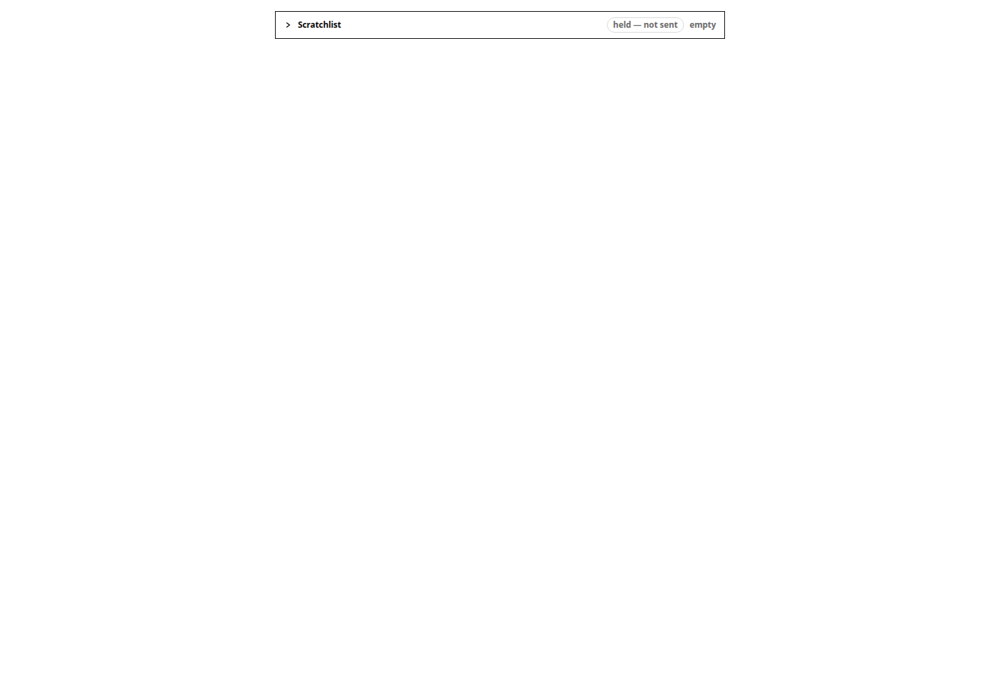

# 暂存清单与消息队列

[简体中文](scratchlist.md) · [English](en/scratchlist.md)

[返回功能目录](index.md)

暂存清单用于先记下来，消息队列用于准备发送给 agent。两者不是同一个列表。

## 添加、排序和删除暂存项

1. 点输入栏“暂存清单”；也可用 `Ctrl/Cmd+Shift+S` 聚焦新增输入。
2. 写入一条待处理事项并添加。
3. 用列表提供的移动/拖动操作整理顺序。
4. 删除不再需要的条目。

清单按会话区分。切换会话后看到另一份清单是正常现象。不要假设暂存内容已经发给 agent。

## 放回输入框或加入队列

| 入口 | 操作 | 验证结果 |
| --- | --- | --- |
| 放入输入框 | 选择条目，点对应按钮 | 输入框出现内容，可继续编辑再发送 |
| 发送到队列 | 选择条目，点加入队列 | 检查队列或发送状态，不以按钮点击作为成功依据 |
| 队列中的编辑/移除 | 点对应消息提供的操作 | 检查新内容或该条是否移除 |

如果发送失败，先查看错误，再决定重试；不要连续重复点击。定时消息的使用见 [定时发送](schedules.md#message)。

## 界面与行为依据

`web/src/components/AssistantChat/ScratchlistPanel.tsx`、`web/src/components/SessionChat.tsx`。截图使用真实组件和演示数据；不代表演示中操作已在真实机器执行。
