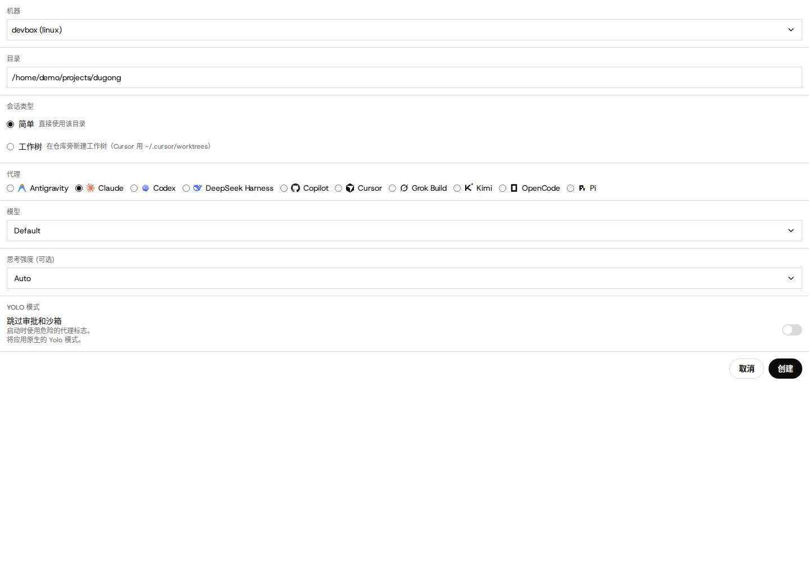
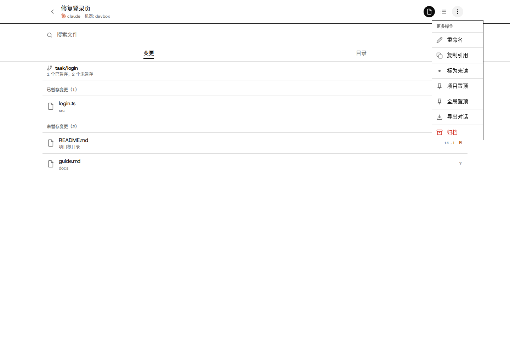

# 会话创建、切换与管理

[简体中文](sessions.md) · [English](en/sessions.md)

[返回功能目录](index.md)

有任务时优先从任务进入会话；也可使用独立会话入口。不同 agent 和 runner 版本提供的选项不同。

## 创建独立会话

1. 打开新建会话入口，选择机器与目录。
2. 选择简单模式或工作树模式，选择 agent。
3. 按该 agent 显示的字段选择模型、推理强度、权限及其他选项。
4. 提交创建；进入会话后发送第一条消息。

机器旁显示“需要更新”时，先升级该机器上的 runner。某些选项会按 agent 能力隐藏，不能仅靠前端选择启用机器尚未支持的功能。

## 切换会话与恢复工作

1. 从任务列表或会话列表选择目标会话。
2. 核对标题下方的机器、路径和 agent，避免在错误项目发送消息。
3. 会话不活跃时，按界面显示的恢复/继续入口操作；能否恢复由 agent 和机器能力决定。
4. 新会话替代了旧会话时，以界面跳转后的当前会话为准。

浏览旧消息通常不要求 agent 正在运行，继续执行、文件和终端操作则可能需要在线连接。

## 会话菜单与导出

会话标题旁的菜单用于当前会话。先核对标题，再执行操作。

| 操作 | 使用方法 | 结果 |
| --- | --- | --- |
| 重命名 | 打开菜单，编辑标题并保存 | 更改展示名称，不改磁盘目录 |
| 导出 | 打开导出对话框，按可用格式生成/下载 | 保存会话记录，区别于单轮图片分享 |
| 复制会话引用 | 选择复制引用，然后粘贴到其他会话 | 带入定位当前会话的信息 |
| 标为未读 | 在菜单点击标为未读 | 留作稍后处理的阅读标记 |
| 项目置顶/全局置顶 | 选择需要的置顶范围，再按菜单取消 | 调整会话优先显示范围 |
| 同步 Codex/Pi | 相应 agent 的菜单出现时点击 | 从对应本地记录同步；支持条件取决于会话状态 |
| 归档/删除等管理项 | 仅在菜单出现时使用，并阅读确认 | 影响会话记录或可见性；不等于 Git 回滚 |

菜单项受会话状态和运行环境影响。删除前保留需要的对话记录。

## 界面与行为依据

`web/src/components/NewSession/index.tsx`、`web/src/components/SessionHeader.tsx`。截图使用真实组件和演示数据；不代表演示中操作已在真实机器执行。
