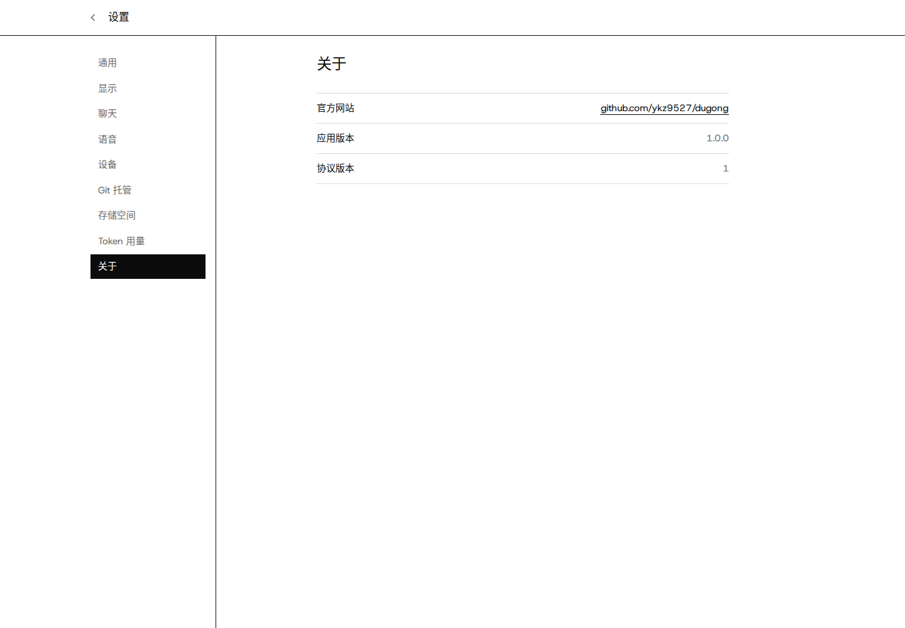

# 设置：版本与项目入口

[返回功能目录](index.md)

排查问题前记录 CLI、hub 和网页版本，避免把不同版本的界面混在一起。

## 查看版本并打开项目页面

1. 打开“设置 → 关于”。
2. 记录应用版本和协议版本。
3. 点击项目链接进入仓库，查看 Release、使用文档和问题记录。
4. 报告问题时附上版本、设备类型、复现步骤及脱敏截图。

截图来自文档开发环境，可能显示尚未发布的 1.0.0。实际可安装版本以 [Releases](https://github.com/ykz9527/dugong/releases) 与 npm 为准。

## 界面与行为依据

`web/src/routes/settings/about.tsx`。截图使用真实组件和演示数据；不代表演示中操作已在真实机器执行。
