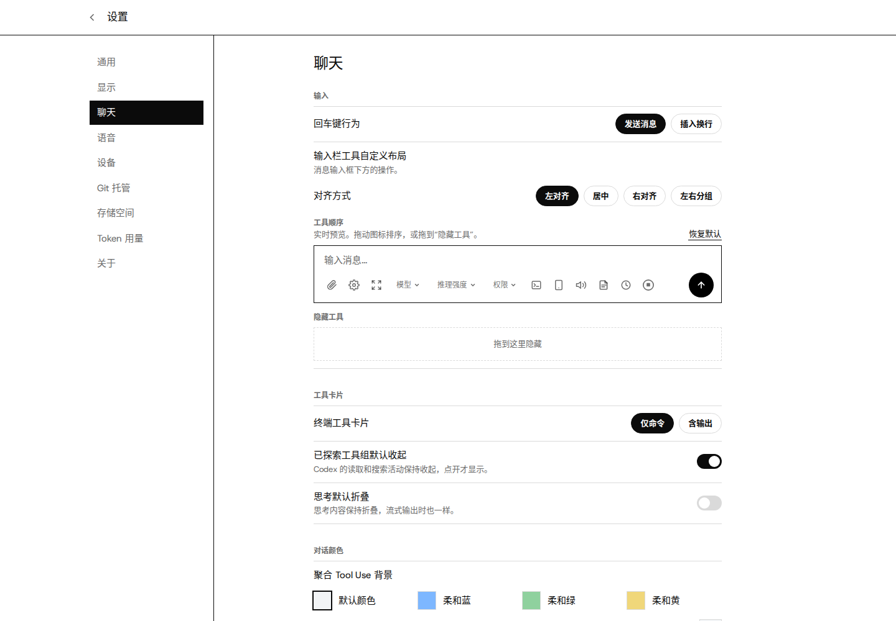
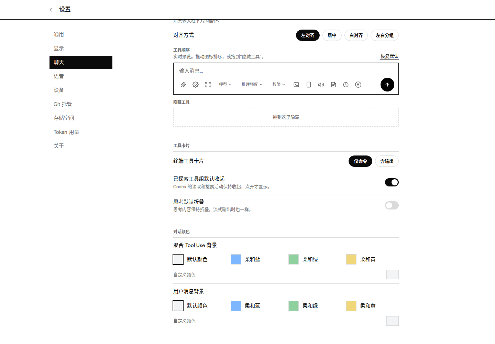

# 设置：输入行为与工具条

[简体中文](settings-chat.md) · [English](en/settings-chat.md)

[返回功能目录](index.md)

打开“设置 → 聊天”。隐藏按钮后，可以在此恢复，不必重新安装。

## 设置回车行为

1. 找到“回车键行为”。
2. 选择发送消息或插入换行。
3. 返回输入框试写一段短草稿，确认符合习惯。

不确定快捷键时使用明确的发送按钮，避免误发长草稿。

## 排列、分组和隐藏输入栏工具

1. 选择左对齐、居中、右对齐或左右分组。
2. 拖动图标排序；左右分组时可以跨组移动。
3. 把不常用的操作拖到“隐藏工具”，或使用对应的隐藏操作。
4. 需要恢复时在隐藏区选择显示；想全部重置时点“恢复默认”。

可调整附件、会话设置、展开编辑器、模型、推理强度、权限、终端、中止、远程切换、麦克风、暂存清单和定时发送等工具。实际可见项仍受 agent 与当前会话状态限制。

## 工具卡片、思考过程与颜色

1. 在终端工具卡片设置中选择“仅命令”或界面提供的完整展示方式。
2. 根据偏好设置探索类工具和推理过程的默认折叠行为。
3. 选择用户消息、工具卡片和聚合工具背景色；需要时使用自定义颜色或恢复默认。

折叠只影响呈现，不是删除消息。想查看完整执行过程时，展开对应卡片并阅读输出。

## 界面与行为依据

`web/src/routes/settings/chat.tsx`、`web/src/components/settings/ComposerToolbarLayoutControl.tsx`。截图使用真实组件和演示数据；不代表演示中操作已在真实机器执行。
