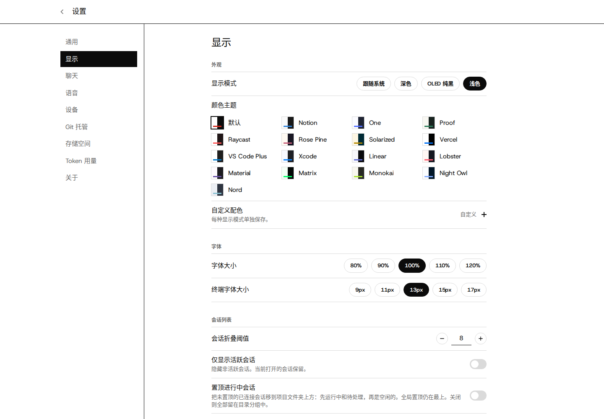
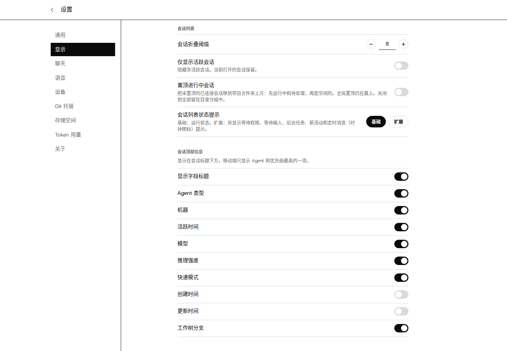

# 设置：外观、字体与会话显示

[简体中文](settings-display.md) · [English](en/settings-display.md)

[返回功能目录](index.md)

这些控件改变界面显示，不更改项目文件。长页面向下滚动可以看到会话头信息和自定义颜色。

## 选择外观和颜色主题

1. 打开“设置 → 显示”。
2. 选择跟随系统、深色、OLED 纯黑或浅色。
3. 在颜色主题中选择喜欢的方案，查看实时变化。
4. 需要细调时展开自定义颜色，修改对应颜色项；可对单项或全部恢复默认。

自定义颜色按外观模式保存。切换浅色/深色后先检查当前正在编辑哪套颜色。

## 调整正文与终端字体

1. 在字体区域选择界面字号。
2. 单独选择终端字号。
3. 返回长对话或终端检查阅读与换行效果。

正文与终端字号是独立设置。放大字体后，一屏可见信息会减少。

## 调整会话列表和标题信息

| 控件 | 操作 | 结果 |
| --- | --- | --- |
| 折叠前会话数量 | 使用减号和加号调整 | 改变分组折叠前显示的会话数 |
| 仅活跃会话 | 开启/关闭 | 改变会话列表过滤，不删除历史 |
| 进行中会话置顶 | 开启/关闭 | 优先显示进行中的会话 |
| 会话列表状态 | 选择状态展示方式 | 调整列表里的状态信息密度 |
| 会话头字段 | 开关机器、模型、推理强度、时间、worktree 等字段 | 控制标题下显示的信息 |
| 显示标签 | 开关字段标签 | 改变名称与数值的呈现方式 |

手机标题空间较小，只展示部分优先信息。任务列表按状态分组的逻辑与会话列表偏好并不完全相同。

## 界面与行为依据

`web/src/routes/settings/display.tsx`。截图使用真实组件和演示数据；不代表演示中操作已在真实机器执行。
