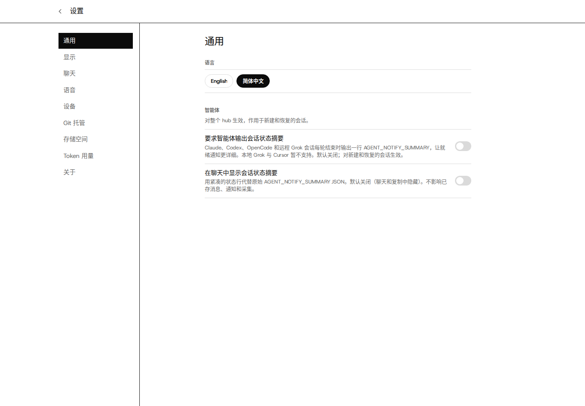

# 设置：通用与会话摘要

[简体中文](settings-general.md) · [English](en/settings-general.md)

[返回功能目录](index.md)

从设置入口选择“通用”。语言与部分显示偏好保存在当前浏览器；hub 级开关会影响其他新建或恢复的会话。

## 切换界面语言

1. 打开“设置 → 通用”。
2. 在“语言”中选择 English 或简体中文。
3. 返回任务页确认界面文字变化。

语言选择不会自动翻译已有提示词、任务标题或对话。

## 会话状态摘要

| 开关 | 如何使用 | 生效范围 |
| --- | --- | --- |
| 要求智能体输出会话状态摘要 | 开启后，在新建或恢复的会话中观察每轮结束摘要 | hub 级；仅支持的 agent/模式执行该约定 |
| 在聊天中显示会话状态摘要 | 开启后查看聊天中的紧凑状态行 | 显示偏好；不改变已存消息和通知采集 |

Claude、Codex、OpenCode 和远程 Grok 可使用摘要约定；本地 Grok 与 Cursor 暂不支持。开关不意味着已经在运行的所有会话会立即重新配置。

## 界面与行为依据

`web/src/routes/settings/general.tsx`。截图使用真实组件和演示数据；不代表演示中操作已在真实机器执行。
