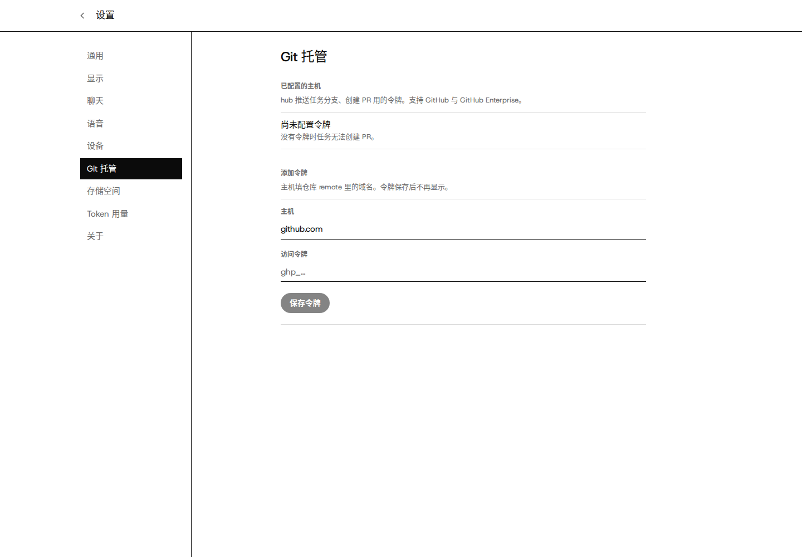

# 设置：Git 托管凭据

[简体中文](settings-git.md) · [English](en/settings-git.md)

[返回功能目录](index.md)

这里配置 hub 用于任务分支推送和 PR 的托管凭据。不会自动替代机器上所有 Git/SSH 配置。

## 添加主机与 token

1. 打开“设置 → Git 托管”。
2. 主机填写 `github.com` 或实际 GitHub Enterprise 主机。
3. 填入对目标仓库具备所需权限的 token，保存。
4. 回到任务详情尝试打开 PR，按结果处理权限或 remote 问题。

主机与仓库 remote 必须对应。不要填写整个仓库 URL 代替主机名。

## 检查、替换和移除凭据

1. 在已配置主机列表查看主机名和遮罩提示。
2. 替换 token 时重新填写并保存。
3. 不再使用该主机时点击删除/移除入口。

移除后，依赖该凭据的推送或 PR 操作可能失败；已经存在的 GitHub PR 不会因此消失。页面保存成功也不代表 token 对所有仓库都有权限。

## 界面与行为依据

`web/src/routes/settings/git-host.tsx`。截图使用真实组件和演示数据；不代表演示中操作已在真实机器执行。
