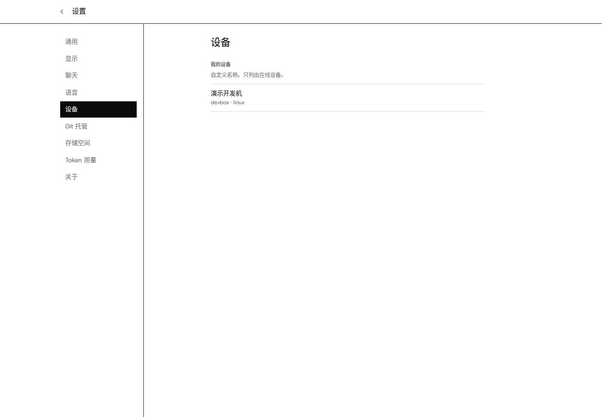
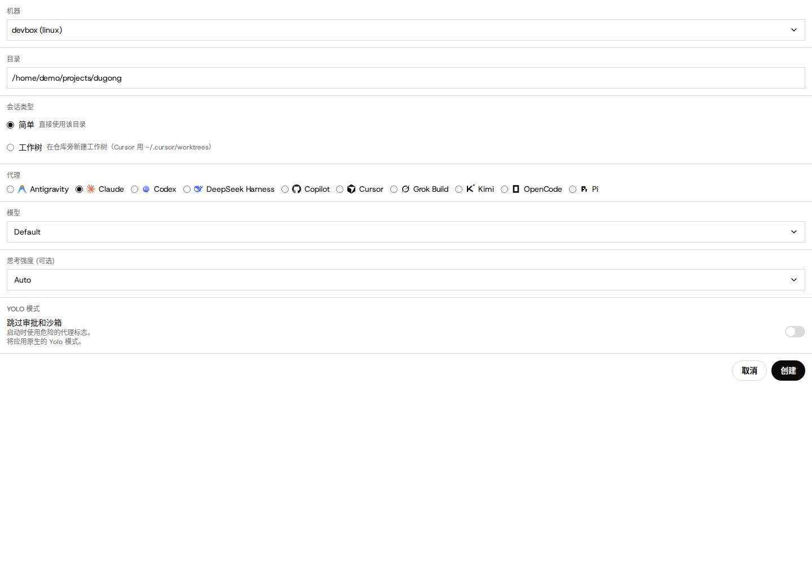

# 设置：设备名称与机器连接

[简体中文](settings-machines.md) · [English](en/settings-machines.md)

[返回功能目录](index.md)

在设置里识别在线机器；启动和登录 runner 仍在对应机器的终端完成。

## 查看和修改设备名称

1. 打开“设置 → 设备”。
2. 核对在线机器的主机名与系统类型。
3. 点击名称旁的编辑入口，填写易识别的名称并保存。
4. 返回任务创建页面确认机器名称。

这会改 dugong 的展示名称，不会修改操作系统 hostname。该页面只列在线设备；机器消失时先检查 runner，而不是重新创建机器记录。

## 机器不出现时如何处理

1. 在目标机器确认 `dugong --version` 和 agent CLI 可用。
2. 确认 runner 使用与网页相同的 hub 地址和凭据。
3. 启动 `dugong runner start --workspace-root /path/to/projects`。
4. 回到设备页或任务创建页等待连接状态更新。

机器在线但目录无法浏览时，检查 workspace roots；机器显示需要更新时，升级 CLI 并重启该机器的 runner。

## 界面与行为依据

`web/src/routes/settings/machines.tsx`、`cli/README.md`。截图使用真实组件和演示数据；不代表演示中操作已在真实机器执行。
