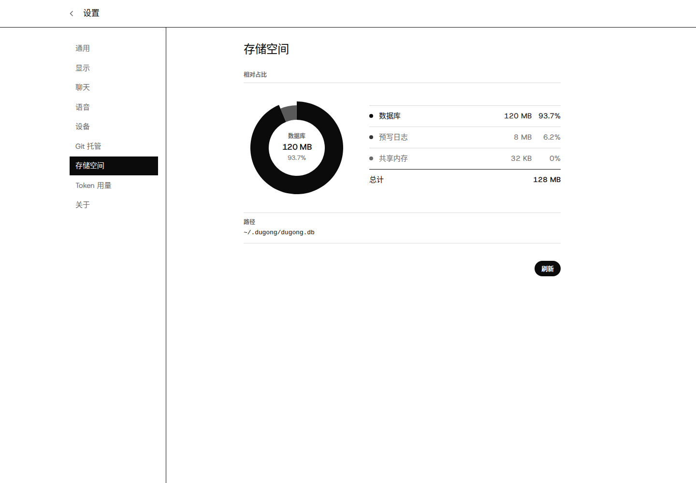

# 设置：存储空间

[简体中文](settings-storage.md) · [English](en/settings-storage.md)

[返回功能目录](index.md)

存储统计是 hub 的 SQLite 文件占用，不是整个项目磁盘用量。该入口供 hub 所有者使用。

## 查看数据库、WAL 与共享内存

1. 打开“设置 → 存储空间”。
2. 查看数据库路径、总大小和各部分占比。
3. 点“刷新”重新读取文件大小。

| 项目 | 代表什么 |
| --- | --- |
| 数据库 | 持久化数据库文件 |
| 预写日志（WAL） | SQLite 的预写日志文件 |
| 共享内存（SHM） | SQLite 共享内存索引文件 |

页面没有提供一键清空数据库。不要手工删除正在使用的 WAL/SHM 来“腾空间”；需要维护时先按部署流程备份并停服务。

## 界面与行为依据

`web/src/routes/settings/storage.tsx`。截图使用真实组件和演示数据；不代表演示中操作已在真实机器执行。
