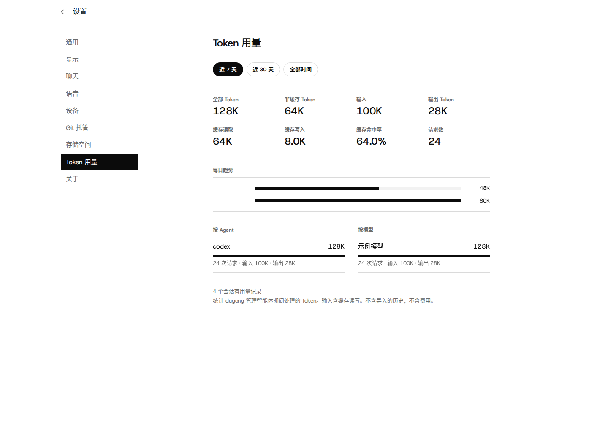

# 设置：Token 用量

[简体中文](settings-usage.md) · [English](en/settings-usage.md)

[返回功能目录](index.md)

Token 用量按 hub 已采集的用量记录汇总，供所有者查看；不是服务商的最终账单。

## 选择时间范围

1. 打开“设置 → Token 用量”。
2. 点击近 7 天、近 30 天或全部时间。
3. 查看总量和每日柱形图，确认自己选择的范围。

页面按浏览器时区请求汇总。记录为空时先确认是否有受支持的用量事件被采集。

## 理解缓存与分类统计

| 指标或区域 | 如何阅读 |
| --- | --- |
| 全部 Token | 当前范围汇总量 |
| 输入/输出 | 区分输入上下文与模型输出 |
| 缓存读取/创建 | 查看缓存相关消耗 |
| 非缓存 Token | 单独观察不走缓存的部分 |
| 请求数/会话数 | 理解汇总覆盖的活动规模 |
| 按 agent/模型 | 对比不同来源的用量 |

不同 agent 的统计能力可能不同。不能直接把 Token 数乘一个统一价格当作账单。

## 界面与行为依据

`web/src/routes/settings/usage.tsx`。截图使用真实组件和演示数据；不代表演示中操作已在真实机器执行。
