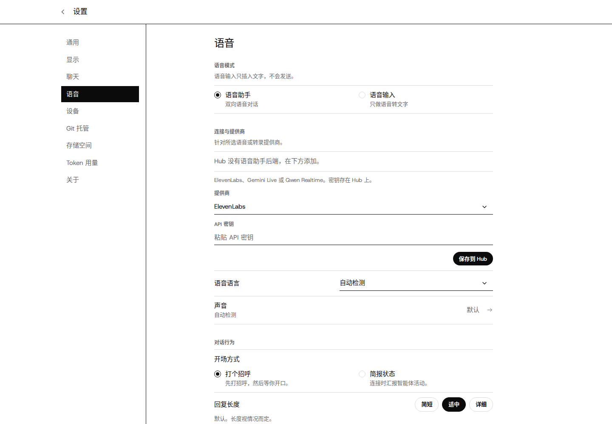
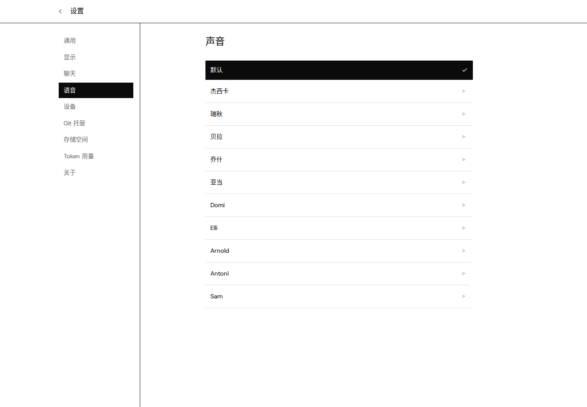
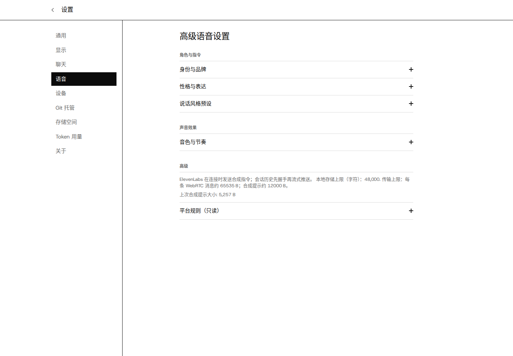

# 设置：语音输入与语音助手

[返回功能目录](index.md)

语音输入把声音转成输入框文字；语音助手提供双向语音对话。截图展示尚未配置后端的状态，真实可选项由管理员配置决定。

## 选择语音模式并连接

1. 打开“设置 → 语音”。
2. 选择语音输入或语音助手。
3. 选择可用服务和输入模式，再回到会话使用麦克风按钮。
4. 浏览器请求麦克风权限时确认授权；语音输入完成后先检查文字，再手动发送。

语音输入不会自动发送消息。若显示没有可用服务，需要先配置服务凭据；HTTPS、设备麦克风和浏览器权限也必须可用。

## 配置语音服务凭据

1. 打开语音页的连接/服务配置区域。
2. 选择需要的转写或语音后端，填写该服务要求的凭据和地址。
3. 保存后确认页面显示已配置，再试一次短语音。

环境变量提供的凭据可能只读；请按字段旁说明处理。界面只展示遮罩或来源，不应把真实密钥放入截图。各服务计费与登录方式由服务商决定。

## 选择声音并试听

1. 从语音设置打开“声音”。
2. 按可用后端、语言或搜索条件选择声音。
3. 点试听按钮确认效果，再选择需要的声音。
4. 返回会话进行短对话验证。

列表中的声音能否使用取决于后端配置。没有后端时，列表可显示默认选项，但不代表已经能合成语音。

## 调整角色、说话方式与诊断

1. 打开“高级语音设置”。
2. 依次展开身份与品牌、性格与表达、说话风格、声音效果或音色节奏等分组。
3. 每次只改一组，返回会话测试效果。
4. 连接异常时查看诊断项；恢复默认后再验证基础连接。

高级参数不是所有语音后端通用，按当前页面标注的支持范围使用。角色指令不能替代 coding agent 的权限控制。

## 界面与行为依据

`web/src/routes/settings/voice.tsx`、`web/src/routes/settings/voice-voices.tsx`、`web/src/routes/settings/voice-advanced.tsx`。截图使用真实组件和演示数据；不代表演示中操作已在真实机器执行。
