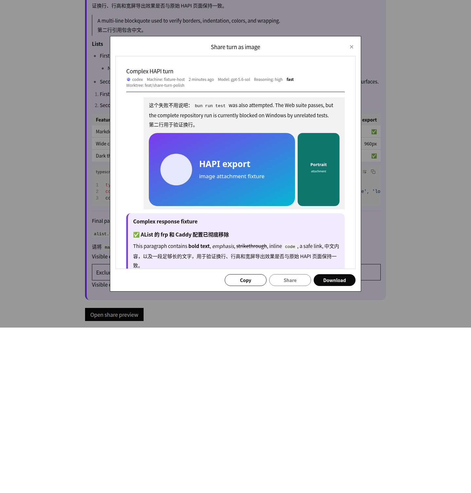
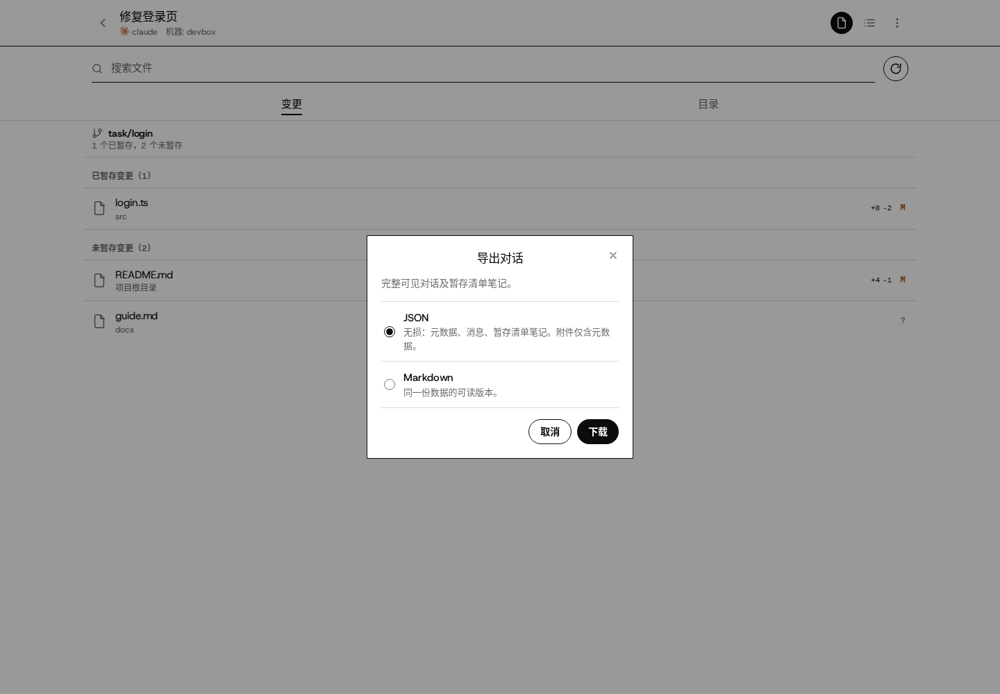

# 复制、导出与图片分享

[简体中文](sharing.md) · [English](en/sharing.md)

[返回功能目录](index.md)

短内容用复制；需要展示一轮对话时用图片分享；需要保存整段会话时用会话导出。

## 把一轮对话分享成图片

1. 找到要分享的那一轮消息，点击“将本轮对话分享为图片”。
2. 在预览中检查包含的文字、代码和图片。
3. 选择“复制”“下载”或“分享”，按浏览器能力完成保存。
4. 发给别人前检查是否含私密路径、凭据或不宜公开的对话。

分享预览会处理部分工具输出与交互控件，不是浏览器原样截图。请以预览和导出的图片为准。

## 保存整段会话

1. 打开会话标题菜单中的导出入口。
2. 选择 JSON 或 Markdown。JSON 保留元数据、消息与暂存清单笔记；Markdown 是同一份数据的可读版本。附件仅含元数据。
3. 生成导出，等待完成后下载。
4. 打开文件确认标题、时间和内容范围。

图片分享与完整会话导出用途不同。浏览器不允许写入剪贴板或调用系统分享时，优先使用下载。

## 界面与行为依据

`web/src/components/AssistantChat/ShareTurnDialog.tsx`、`web/src/components/SessionHeader.tsx`。截图使用真实组件和演示数据；不代表演示中操作已在真实机器执行。
