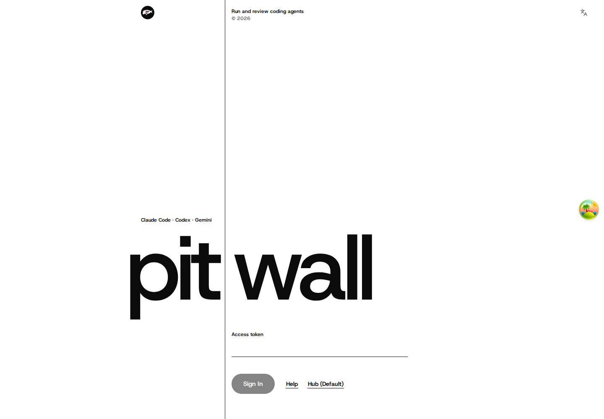
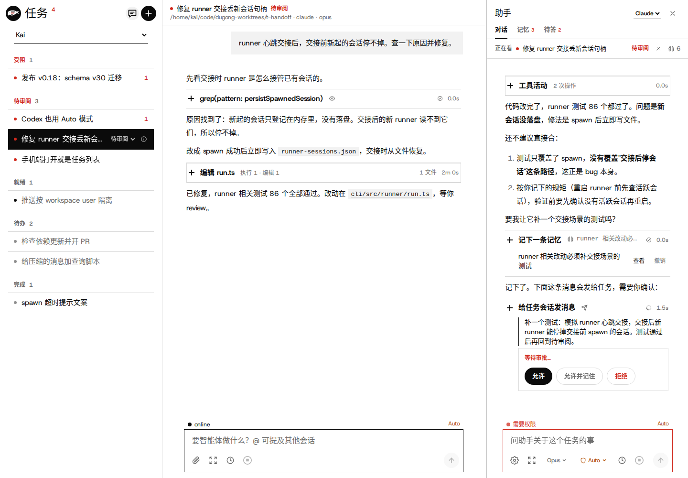
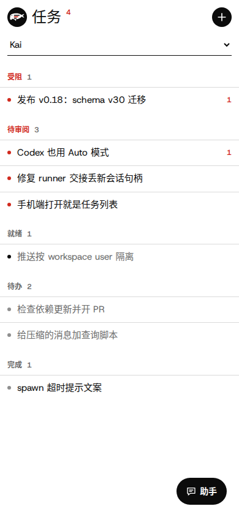

# 开始使用与界面导航

[返回功能目录](index.md)

先连接 hub，再在同一 hub 上连接运行 agent 的机器。以下说明以 0.30.0 发布后的界面为基准；1.0.0 尚未发布，截图中的开发版本号不代表发布状态。

## 连接与登录

1. 打开自己的 hub 地址。默认是 `http://localhost:3006`，管理员改过端口时使用实际地址，例如 `http://10.176.37.2:3008`。
2. 在登录页确认 hub 地址，输入管理员提供的访问 token。不要使用截图中的示例数据登录。
3. 登录后进入任务列表；选择任务即可打开它的会话。

需要从零安装时，先执行 `npm install -g @ykz9527/dugong`，然后分别启动 `dugong hub` 和 `dugong runner start --workspace-root ~/code`。agent CLI 还需要在执行机器上安装并登录。

当前登录页可能仍显示旧名称 pitwall；请以你部署的 hub 地址确认服务。token 是访问凭据；工作区用户下拉框不能替代登录认证。

## 认识桌面工作区

| 点击哪里 | 操作 | 看到什么 |
| --- | --- | --- |
| 左侧任务标题 | 选择任务 | 中间切换到对应会话 |
| 任务行的详情按钮 | 桌面上先悬停任务行再点击 | 任务提示词、状态、目录、PR、计划与运行历史 |
| 顶部加号 | 新建任务 | 任务创建表单 |
| 用户选择器 | 选全部或某个用户 | 任务列表按用户目录范围筛选 |
| 任务助手按钮 | 打开或关闭助手 | 右侧助手面板 |

桌面可以并排查看任务、会话和助手。手机因空间较小，会切换页面或打开覆盖面板。

## 手机访问与安装

1. 手机上打开可访问的 hub 地址。仅局域网地址需要手机与服务器处于可达的网络。
2. 在任务列表点任务标题进入会话，用返回按钮回到列表。
3. 在浏览器菜单选择“添加到主屏幕”或“安装应用”；名称取决于浏览器。
4. 需要远程访问时，可由管理员启动 `dugong hub --relay`，使用终端给出的 HTTPS 地址。

默认 relay 属于上游 HAPI。自有网络入口需另行配置，参见 [部署指南](../guide/deployment.md)。通知、麦克风和剪贴板能力取决于 HTTPS、浏览器及系统权限。

## 界面与行为依据

`README.md`、`web/src/router.tsx`、`web/src/hooks/useAuth.ts`。截图使用真实组件和演示数据；不代表演示中操作已在真实机器执行。
