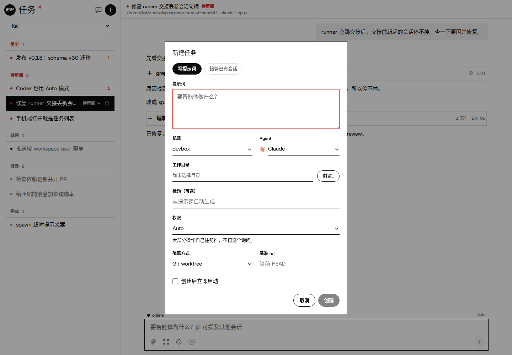
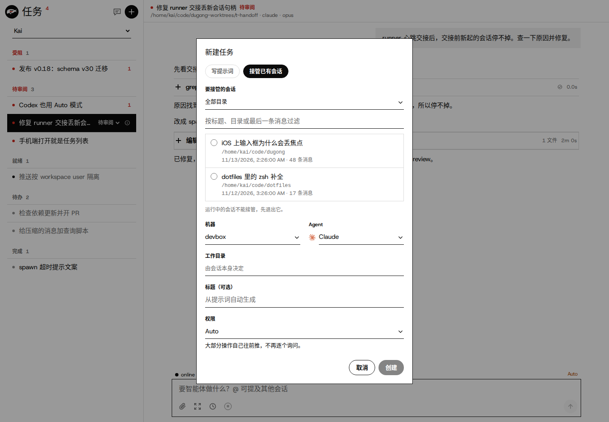
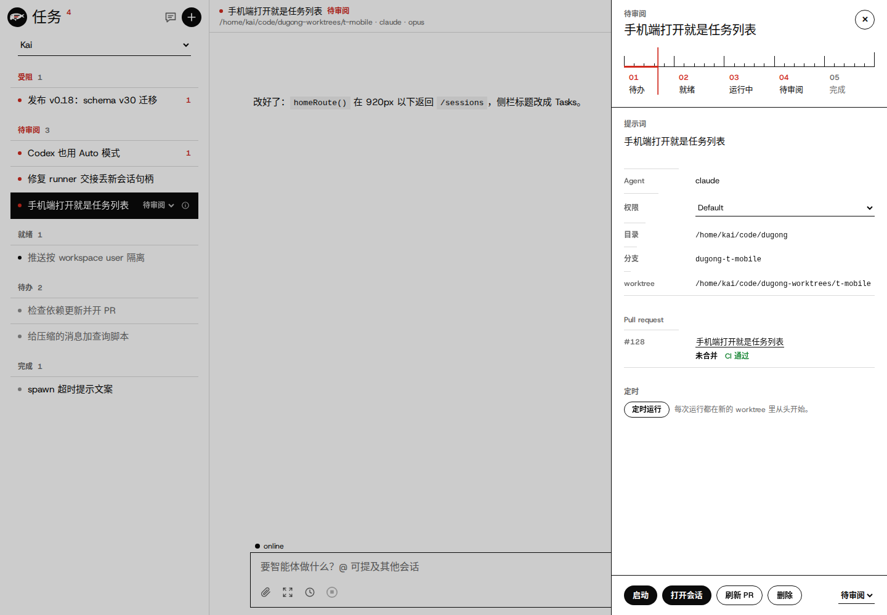
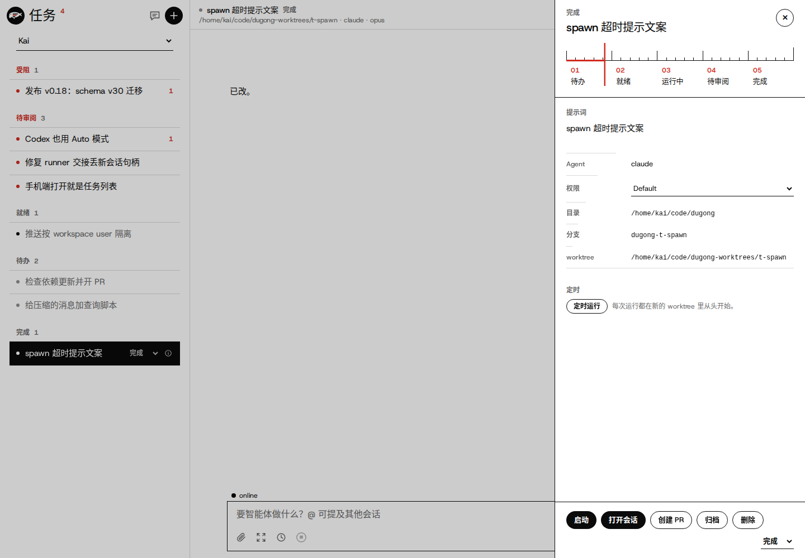

# 任务列表、状态与生命周期

[返回功能目录](index.md)

任务记录工作目标、执行机器、目录和 agent；会话记录具体对话。先创建任务，再从详情启动或继续执行。

## 查看和筛选任务

1. 查看左侧按状态分组的任务；先处理“受阻”和“待审阅”。
2. 点有会话的任务标题，读取最新消息。没有会话的任务从“详情”启动。
3. 用用户选择器切换范围；找不到任务时先检查当前用户及归档区域。

| 状态 | 含义 | 建议操作 |
| --- | --- | --- |
| 待办 | 尚未开始 | 补充提示词后启动 |
| 就绪 | 已停止或普通失败后可以重试 | 查看运行记录再启动 |
| 运行中 | agent 或受跟踪的后台工作在执行 | 观察输出，需要时停止 |
| 受阻 | 会话、runner、提示词投递等外部环节异常 | 读错误信息，恢复环境后重跑 |
| 待审阅 | 一轮结束，或在等权限/回答 | 审阅、批准或补充要求 |
| 完成 | 用户确认收尾 | 检查成果后归档 |

状态代表执行阶段，不代表测试通过或代码已合并。

## 创建新任务

1. 点任务列表顶部的加号。
2. 在“提示词”写目标、约束和验收方式，例如“修复登录页回车提交，补测试并说明结果”。
3. 选机器和 agent，点“浏览”选工作目录；也可按表单支持的方式填写路径。
4. 选择权限和隔离方式，必要时填基准 ref。
5. 可填一个短标题；选择是否立即开始，再点“创建”。

| 表单项 | 如何选择 | 影响 |
| --- | --- | --- |
| 机器 | 选择在线 runner | 决定代码在哪台机器执行 |
| 工作目录 | 选择项目目录 | 远端路径，不是手机目录 |
| agent | 选择已安装并登录的 CLI | 决定运行哪种智能体 |
| 权限 | 从较小授权开始 | 决定哪些操作会请求批准 |
| worktree | 并行改 Git 仓库时选 | 每个任务使用独立工作目录与分支 |
| 简单模式 | 直接使用原目录时选 | 多个任务可能修改同一目录 |
| 基准 ref | 填现有分支或 commit | worktree 的起点 |

机器为空时先检查 runner 与 hub 的连接。浏览器看不到的目录需由 runner 的 `--workspace-root` 开放。

## 把已有会话接为任务

1. 打开“新建任务”，切换来源为已有会话。
2. 选择机器，并在可用的导入/接管列表中选择原对话。
3. 核对原对话目录和标题，创建任务。
4. 在任务详情打开会话继续交流。

接管任务的“对话的起点”仅作描述。启动时继续原对话，不会再次发送这段描述。可接管的类型以当前界面与机器能力为准，不是每种 agent 都支持同样的历史导入。

## 启动、停止和切换状态

1. 打开任务详情，核对提示词和目录。
2. 点“启动”；正常情况下出现新运行记录并进入运行中。
3. 需要中断时点“停止”，再查看最后输出和运行结果。
4. 修改要求后可以再次启动，或在已有会话中发送补充消息。
5. 验收完成后用“状态”选择完成。

手动切换状态不会替你验证代码，也不等于 Git 提交、推送或合并。停止是否成功应以界面结果为准。

## 归档、恢复和删除

| 入口 | 操作步骤 | 结果与注意事项 |
| --- | --- | --- |
| 归档 | 打开详情，点击归档并阅读确认信息 | 任务移到归档区域；运行中任务可能要求先停止 |
| 恢复 | 展开已归档任务，打开详情，点恢复 | 任务回到日常列表 |
| 删除 | 点删除，核对确认提示，再确认 | 删除任务记录；不作为普通收纳方式 |
| 未提交改动提示 | 先检查文件差异和需保留的内容 | 不要把“仍然归档/删除”当成自动备份 |

worktree 任务的归档可能涉及收尾和清理。出现“会话仍在运行”提示时，先处理残留进程，不要只看任务已从列表消失。

## 界面与行为依据

`web/src/components/Tasks/NewTaskDialog.tsx`、`web/src/components/Tasks/TaskDetail.tsx`、`web/src/components/Tasks/useTaskLifecycle.ts`。截图使用真实组件和演示数据；不代表演示中操作已在真实机器执行。
