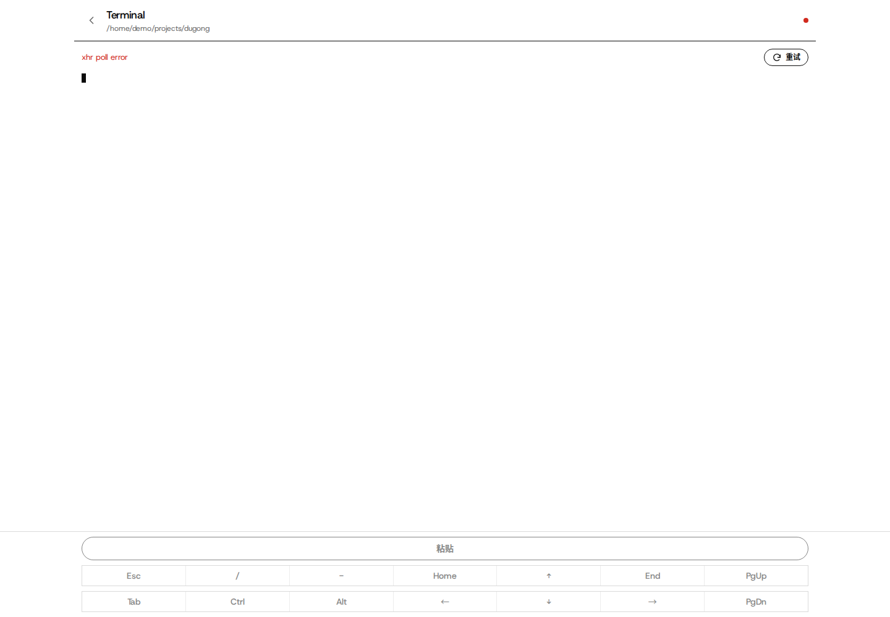
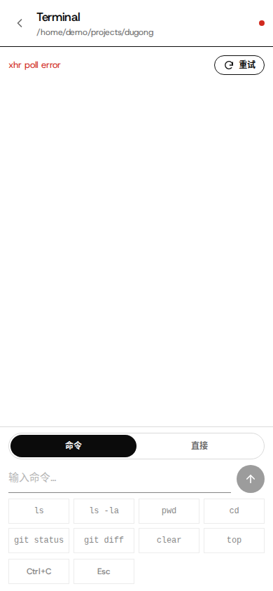

# 远程终端与命令输入

[返回功能目录](index.md)

终端在执行机器上运行命令，不是在手机或浏览器本机执行。需要会话与机器连接可用。

## 打开终端与连接检查

1. 在会话标题或输入栏点击终端入口。
2. 确认对应机器与目录，等待连接状态就绪。
3. 连接失败时使用“重试”，同时检查 runner 与 hub 是否在线。

不支持远程终端的主机会显示提示。不要把会话中的工具输出卡片误认为可输入命令的终端。截图使用隔离的演示连接状态，不连接真实 shell。

## 命令模式、直接模式与粘贴

| 控件 | 怎么使用 | 结果 |
| --- | --- | --- |
| 命令 | 在命令输入框编辑，然后点“执行命令” | 整条命令发到终端 |
| 直接 | 切换后向终端直接输入按键 | 适合交互程序和快捷键 |
| 控制/导航/Shell/符号 | 切换手机快捷键分类，再点按键 | 发送对应键或组合键 |
| 粘贴 | 允许剪贴板读取，或在备用弹窗手工粘贴 | 将文本送入当前终端 |

命令/直接模式及按键分类主要用于手机等窄屏布局；桌面通常直接在终端输入。执行前核对命令。终端命令会直接影响远程工作目录，agent 的聊天权限提示不能代替终端操作确认。

## 界面与行为依据

`web/src/routes/sessions/terminal.tsx`。截图使用真实组件和演示数据；不代表演示中操作已在真实机器执行。
