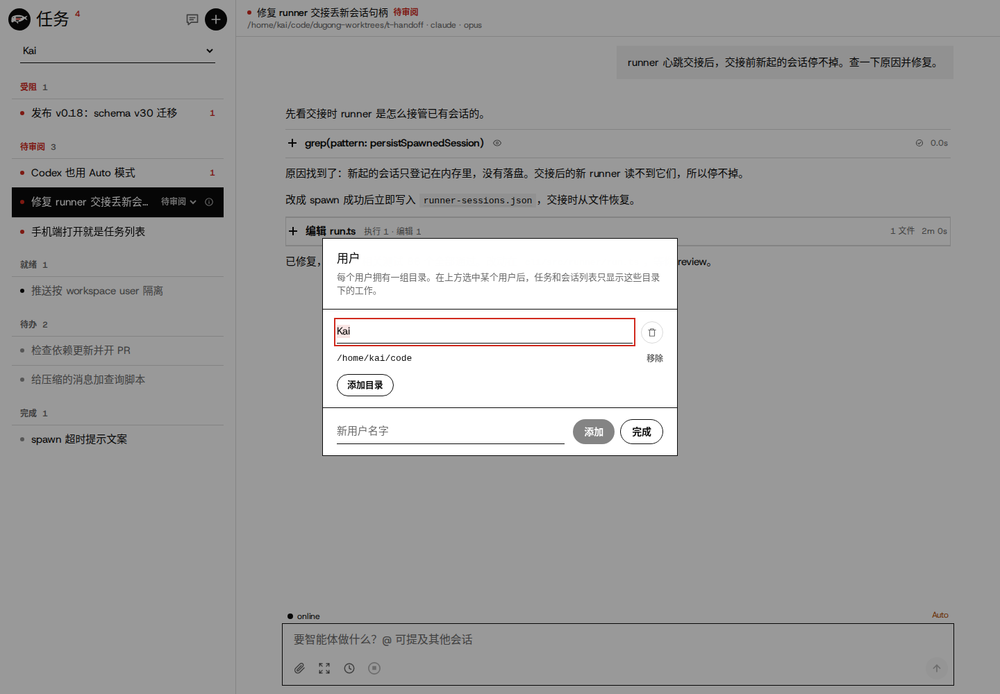

# 工作区用户与目录范围

[简体中文](users.md) · [English](en/users.md)

[返回功能目录](index.md)

工作区用户用于组织任务范围、个人助手与相关设置；namespace 是另一层分隔，但不是访问控制：持有基础 token 的人可以进入任意 namespace。

## 切换当前用户

1. 点任务列表上方的用户选择器。
2. 选择“全部”查看当前登录范围内的任务，或选某个用户查看其目录范围内的任务。
3. 打开助手前确认当前用户，避免把个人记忆写到错误的用户下。

看不到任务时先检查用户与目录配置，不要立即重新创建相同任务。

## 添加、改名与删除用户

1. 在用户选择器点“管理用户…”。
2. 输入新用户名字，点“添加”。
3. 修改现有用户名字时编辑名称，按界面保存/完成。
4. 删除用户时先核对对象，再完成二次确认。

用户管理会影响任务归属视图和助手使用范围，不是创建操作系统账户。

## 配置用户可见目录

1. 在管理用户窗口选中目标用户。
2. 点“添加目录”，选择机器并浏览到需要的项目根目录。
3. 删除错误目录时点“移除”。
4. 返回任务列表切换到该用户，确认任务是否出现。

没有配置目录的用户可能看不到任何任务。目录浏览还受 runner 的 workspace roots 限制。不要把工作区目录筛选当成独立的服务器安全隔离；多用户访问设置见 [namespace 指南](../guide/namespace.md)。

## 界面与行为依据

`web/src/components/WorkspaceUser/WorkspaceUserDialog.tsx`、`web/src/components/WorkspaceUser/WorkspaceUserPicker.tsx`。截图使用真实组件和演示数据；不代表演示中操作已在真实机器执行。
